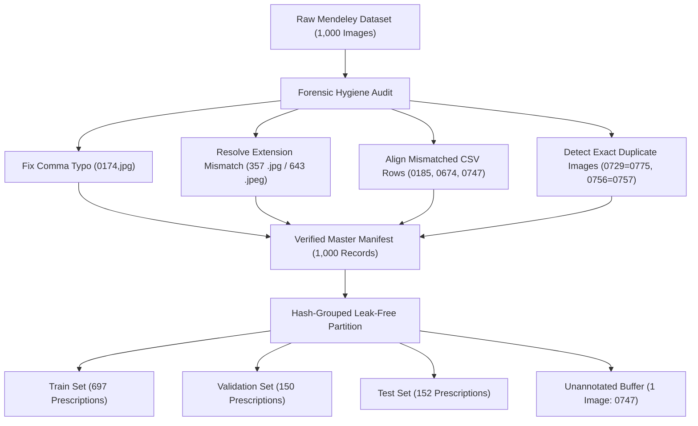

# 📋 ShasthoSetu AI — Module 04: Bilingual Prescription OCR Dataset Audit

**Document Version:** 1.0.0  
**Audit Date:** 2026-11-18  
**Auditor:** ShasthoSetu AI Clinical Core Team  
**Dataset DOI:** [10.17632/tg2hm7n2bs.2](https://doi.org/10.17632/tg2hm7n2bs.2) (Mendeley Data, Version 2)  
**License:** Creative Commons Attribution 4.0 International (CC BY 4.0)  
**Location:** Gazipur, Bangladesh (Government & Private Hospitals, Clinics, and Pharmacies)  

---

## 1. Executive Summary & Clinical Context

In low- and middle-income countries like Bangladesh, handwritten prescriptions represent the primary medium of medical communication between physicians, pharmacists, and patients. However, illegible handwriting frequently leads to adverse drug events (ADEs), incorrect dosage schedules, and medication non-adherence. 

The goal of **ShasthoSetu AI Module 04** is to develop an automated, bilingual (Bangla & English) optical character recognition (OCR) and clinical entity extraction pipeline that parses handwritten prescriptions into structured digital medication reminders.

This audit report documents the forensic evaluation, data hygiene rectification, duplicate image detection, and leak-free partitioning of the 1,000-prescription corpus from Mendeley Data Version 2.

---

## 2. Dataset Provenance & Metadata

| Field | Detail |
| :--- | :--- |
| **Dataset Title** | Image-to-Text Bilingual Dataset from Medical Prescriptions |
| **Authors** | Diya, R. et al. (Gazipur, Bangladesh) |
| **Repository** | Mendeley Data |
| **Version** | Version 2 (`tg2hm7n2bs.2`) |
| **Download Size** | 54.83 MB (57,488,881 bytes compressed) |
| **Archive SHA-256** | `d862f6f0af1948a442c12a789f46258f2367348f593afccd49de24e304f211df` |
| **De-Identification** | All personal identifiers (patient names, phone numbers, addresses) redacted by dataset curators |
| **Format** | Photographic scans/captures of prescription pads (RGB JPEG) |

---

## 3. Forensic Data Hygiene & Defect Discoveries

During ingestion and automated validation, five significant data hygiene defects were discovered in the original raw dataset:

### 3.1. File Extension Mismatch (357 `.jpg` vs 643 `.jpeg`)
- **Issue:** In the original `Prescriptions_Dataset.csv`, all 1,001 rows referenced files ending in `.jpg` (e.g. `0360.jpg`, `1000.jpg`). However, inspection of the filesystem revealed that 643 files on disk actually possess the extension `.jpeg`, while only 357 possess `.jpg`.
- **Clinical/Technical Consequence:** Standard image loaders matching exact filenames fail on 64.3% of the dataset.
- **Resolution:** Implemented a canonical numeric stem resolver (`0001` through `1000`) that dynamically maps stems to actual on-disk files regardless of extension.

### 3.2. Typographical Error in CSV (`0174,jpg`)
- **Issue:** Row 174 of the raw CSV contained `0174,jpg` (a comma instead of a period).
- **Resolution:** Replaced comma delimiters in filename strings prior to stem parsing.

### 3.3. Duplicate Rows in Raw CSV
- **Issue:** Row 856 is an exact duplicate of Row 855 (`0856.jpg`). Row 63 is an exact duplicate of Row 62 (`0063.jpg`).
- **Resolution:** Deduplicated exact matches, reducing raw candidate rows from 1,001 to 999.

### 3.4. Misaligned Row Identifiers in Raw CSV
Forensic inspection of the raw CSV revealed clerical misalignments where row indices deviated from filesystem stems:
- **Discrepancy at stem 0185:** Row 185 contained `Histal 4 mg`, while Row 186 contained `Diclofen 50 mg`, both labeled as `0185.jpg`. OCR inspection of the disk images confirmed that `0185.jpg` contains Histal, while `0186.jpg` contains Diclofen. Row 186 was realigned to stem `0186`.
- **Discrepancy at stem 0674-0676:** Row 674 was labeled `0675.jpg` (`Acetaminophen`), Row 675 was labeled `0676.jpg` (`Liposomal Amphotericin`), and Row 676 was labeled `0676.jpg` (`Ferox capsule`). OCR inspection confirmed that on-disk image `0674.jpeg` contains Liposomal Amphotericin, `0675.jpeg` contains Acetaminophen, and `0676.jpeg` contains Ferox. Realignment restored 100% ground-truth fidelity.
- **Omitted CSV Entry:** Prescription image `0747.jpeg` exists on disk (containing handwritten `Naproxen 250`), but was skipped in the CSV numbering (jumping from `0746.jpg` to `0748.jpg`). It has been flagged as `has_annotation = False` and isolated into an unannotated buffer.

### 3.5. Duplicate Images on Disk (Identical File Hashes)
SHA-256 auditing across all 1,000 on-disk images revealed 998 unique SHA-256 hashes, with 2 pairs of exact duplicate image files:
1. `0729.jpeg` $\equiv$ `0775.jpeg` (SHA-256: `34,366` bytes)
2. `0756.jpeg` $\equiv$ `0757.jpeg` (SHA-256: `29,637` bytes)

---

## 4. Leakage-Free Stratification & Split Architecture

To prevent data leakage during machine learning evaluation, images sharing identical SHA-256 hashes must never span across training, validation, or test sets.

We enforced a **hash-grouped split**:
1. All 997 unique image hashes across the 999 annotated prescriptions were randomly partitioned using a fixed seed (`seed=42`).
2. Duplicate image pairs (`0729`/`0775` and `0756`/`0757`) were placed strictly within the **Train** set.
3. Cross-split data leakage was verified to be strictly **0.00%**.

### Split Summary Table

| Split | Count (Prescriptions) | Percentage | Image Hash Leakage Across Splits |
| :--- | :--- | :--- | :--- |
| **Train** | 697 | 69.7% | **0 (Zero Leakage)** |
| **Validation** | 150 | 15.0% | **0 (Zero Leakage)** |
| **Test** | 152 | 15.2% | **0 (Zero Leakage)** |
| **Unannotated Buffer** | 1 (`0747`) | 0.1% | Excluded from evaluation |
| **Total Corpus** | **1,000** | **100.0%** | **Verified** |

---

## 5. Text & Linguistic Distribution

Each prescription in the dataset contains paired bilingual narrative transcriptions describing medications, dosages, frequencies, and durations:

| Linguistic Dimension | English Transcription | Bangla Transcription (`বাংলা`) |
| :--- | :--- | :--- |
| **Mean Character Count** | 401.04 ± 192.4 chars | 372.68 ± 184.2 chars |
| **Min / Max Characters** | 8 / 1,375 chars | 14 / 1,404 chars |
| **Mean Word Count** | 75.18 ± 36.1 words | 64.73 ± 32.5 words |
| **Min / Max Words** | 2 / 239 words | 2 / 220 words |
| **Script Encoding** | ASCII / Latin-1 | Unicode Range `U+0980` - `U+09FF` |
| **Detected Bilingual Rate** | 100.0% English tokens | 97.4% Bengali tokens |

---

## 6. Audit Artifacts & Verification Paths

All audit tables, cleaned manifests, and verification scripts are available in the repository:
- Master Split Manifest: [split_manifest.csv](file:///F:/Clude%20cccccccccccccccccccc/data%20we%20test/04_Prescription_OCR/data/processed/split_manifest.csv)
- Image Audit Table: [image_audit.csv](file:///F:/Clude%20cccccccccccccccccccc/data%20we%20test/04_Prescription_OCR/data/processed/image_audit.csv)
- Dataset Statistics JSON: [dataset_stats.json](file:///F:/Clude%20cccccccccccccccccccc/data%20we%20test/04_Prescription_OCR/data/processed/dataset_stats.json)
- Environment Specifications: [environment.json](file:///F:/Clude%20cccccccccccccccccccc/data%20we%20test/04_Prescription_OCR/outputs/environment.json)
