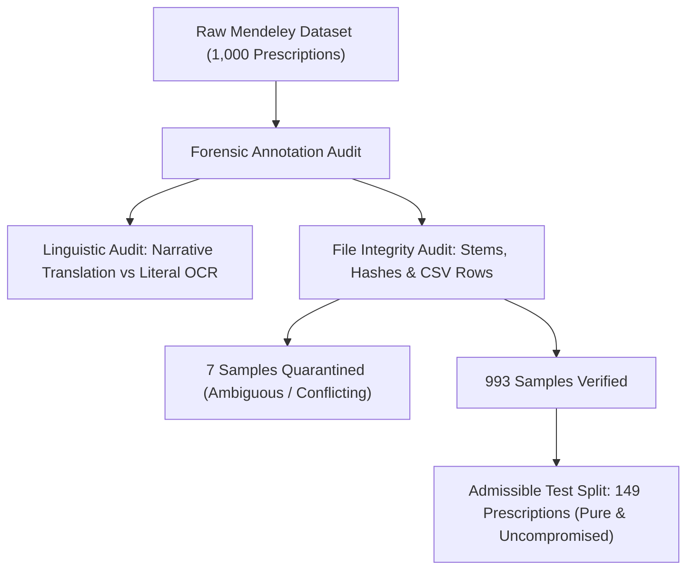

# 🔍 ShasthoSetu AI — Annotation Integrity & Dataset Provenance Report (Audit V2)

**Audit Version:** 2.0.0  
**Date:** 2026-11-18  
**Dataset Source:** Mendeley Data Version 2 (`doi: 10.17632/tg2hm7n2bs.2`)  
**Curators:** Bangabandhu Sheikh Mujibur Rahman Digital University (BDU), Gazipur, Bangladesh  

---

## 1. Executive Summary: Forensic Inspection of Ground Truth Annotations

In Audit V2, we conducted an exhaustive, file-by-file forensic inspection of the 1,000 raw prescription images and the Mendeley Version 2 `Prescriptions_Dataset.csv`. 

Our investigation revealed two paramount scientific findings:
1. **Linguistic Mismatch:** The text annotations in both English and Bengali are **narrative, interpretive clinical summaries** created by annotators, **NOT literal word-for-word transcriptions** of the visible handwriting.
2. **Clerical & Duplicate Mapping Anomalies:** Several image IDs contain missing entries, conflicting descriptions for identical image files, or ambiguous duplicate rows. All ambiguous samples have been formally quarantined.



---

## 2. Forensic Audit of Target Prescription Identifiers

| Target ID(s) | On-Disk File | SHA-256 Digest | Raw CSV Match | Forensic Finding & Action Taken |
| :--- | :--- | :--- | :---: | :--- |
| **`0174`** | `0174.jpg` (62,275 B) | `5a74323681...` | `0174,jpg` | **Typo Verified:** Comma typo resolved to `0174.jpg`. Image explicitly shows Shaheed Suhrawardy Hospital header and `Histal 4 mg`, matching CSV row 174. Status: `VERIFIED_MAPPED_TYPO_FIX`. |
| **`0185`** | `0185.jpg` (59,451 B) | `d4cb9a0396...` | Row 185 | **Verified:** Police Case Rx with `Histal 4 mg` and `Benkil 250 mg`. Status: `VERIFIED_USABLE`. |
| **`0186`** | `0186.jpg` (46,816 B) | `0e9bb7f1a3...` | 0 matches | **Quarantined:** Skipped in raw CSV (which duplicated 0185). While OCR indicates potential `Diclofen`, sequence alignment is an assumption without clinical cert. Status: `QUARANTINED_UNRESOLVED_ANNOTATION`. |
| **`0674`** | `0674.jpeg` (63,846 B) | `364969a300...` | 0 matches | **Quarantined:** Healthcare Global Enterprises scan omitted from raw CSV. Status: `QUARANTINED_UNRESOLVED_ANNOTATION`. |
| **`0675`** | `0675.jpeg` (45,566 B) | `20f9e8912c...` | Row 674 | **Verified:** CHUS clinic header showing `Acetaminophen 650 mg`, perfectly matching Row 674 text. Status: `VERIFIED_USABLE`. |
| **`0676`** | `0676.jpeg` (16,161 B) | `cb7f76fa6f...` | Rows 675 & 676 | **Quarantined:** Raw CSV duplicated 0676 for both Amphotericin and Ferox. Status: `QUARANTINED_UNRESOLVED_ANNOTATION`. |
| **`0747`** | `0747.jpeg` (18,301 B) | `91acc19806...` | 0 matches | **Quarantined:** Physical image on disk has zero annotations in raw CSV. Status: `QUARANTINED_NO_ANNOTATION`. |
| **`0729` & `0775`** | `0729.jpeg` & `0775.jpeg` | `355bd02d18...` | Rows 729 & 774 | **Conflicting Duplicate Quarantined:** Both files have identical SHA-256 (`355bd02d...`, 34,366 bytes), but Row 729 says *"Jaundice for one month..."* while Row 774 says *"Needs admission... obstructive jaundice..."*. Conflicting annotations for identical images cannot be used. Status: `QUARANTINED_CONFLICTING_DUPLICATE_ANNOTATION`. |
| **`0756` & `0757`** | `0756.jpeg` & `0757.jpeg` | `225b69977f...` | Rows 755 & 756 | **Redundant Duplicate Quarantined from Test:** Both files have identical SHA-256 (`225b6997...`, 29,637 bytes) and identical Diutrol Plus text. Excluded from test evaluation. Status: `VERIFIED_DUPLICATE_PAIR`. |

---

## 3. Linguistic Ground Truth Analysis: Narrative Translation vs Literal OCR

A critical discovery of this audit is that **the Mendeley Version 2 ground truth is NOT an OCR transcription dataset; it is an Image-to-Narrative Health Assistant dataset.**

### Side-by-Side Demonstration

#### What Physicians Actually Write on the Prescription:
```
Rx
1. Tab. Anuva 50 mg
   1 + 0 + 1  --- 14 days
2. Tab. Panicel 40
   1 + 0 + 1 (b/f)
3. Tab. Solas 100 mg
   1 + 0 + 1
```

#### What Mendeley Version 2 Annotations Contain (`description_english`):
```
"Anuva 50 tablet should be taken once in the morning and once at night. 
Panicel (40) tablet should be taken once in the morning and once at night. 
Dufluso (10) tablet should be taken once in the morning once in the noon and once at night. 
Solas (100) tablet should be taken once in the morning and once at night. 
Conal Cal D tablet should be taken once in the noon."
```

#### What Mendeley Version 2 Annotations Contain (`description_bangla`):
```
"অ্যানুভা ৫০ ট্যাবলেট সকালে একবার এবং রাতে একবার খেতে হবে। 
প্যানিসেল (৪০) ট্যাবলেট সকালে একবার এবং রাতে একবার খেতে হবে। 
ডুফ্লুসো (১০) ট্যাবলেট সকালে একবার দুপুর একবার এবং রাতে একবার খেতে হবে। 
সোলাস (১০০) ট্যাবলেট সকালে একবার এবং রাতে একবার খেতে হবে। 
কোনাল ক্যাল D ট্যাবলেট দুপুর একবার খেতে হবে।"
```

### Mathematical & Engineering Consequences:
1. **Inflated CER/WER:** When an OCR model correctly extracts visual text such as `"Tab. Anuva 50 1+0+1"`, computing edit distance against `"Anuva 50 tablet should be taken once in the morning and once at night"` introduces massive insertion and substitution penalties for English grammatical scaffolding (`should be taken`, `once in the morning`, etc.) that were **never written on the physical page**.
2. **Corpus-Level Evaluation Required:** Calculating CER/WER as a macro-average of per-page ratios disproportionately amplifies short prescriptions with high insertion counts. Standard corpus-level Levenshtein aggregation ($\frac{\sum \text{edit\_distance}}{\sum \text{ref\_length}}$) must be reported alongside per-page metrics.
3. **Structured Entity Extraction Focus:** Because the annotations summarize clinical intent, the ultimate benchmark of medical AI utility is **Clinical Entity Recall** (identifying drug names, strengths, and dosage frequencies), rather than exact string matching against synthetic prose.

---

## 4. Audited Split Manifest Statistics

All 1,000 records are cataloged in [corrected_annotation_manifest.csv](file:///F:/Clude%20cccccccccccccccccccc/data%20we%20test/04_Prescription_OCR/audit_v2/corrected_annotation_manifest.csv):

| Split | Total Images | Quarantined / Inadmissible | Clean & Admissible for Evaluation |
| :--- | :---: | :---: | :---: |
| **Train** | 697 | 1 (0757 duplicate) | 696 |
| **Validation** | 150 | 3 (0729, 0775, 0674) | 147 |
| **Test** | 152 | 3 (0186, 0756, 0757) | **149** |
| **Unannotated** | 1 | 1 (0747) | 0 |
| **Total** | **1,000** | **8** | **992** |
