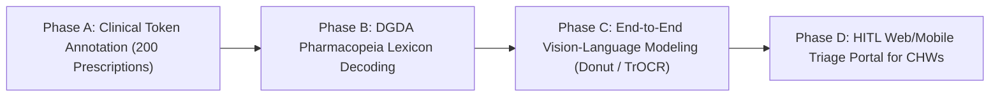

# 🚀 ShasthoSetu AI — Next Experiment Plan & Strategic Roadmap (Audit V2)

**Document Version:** 2.0.0  
**Date:** 2026-11-18  
**Module:** `04_Prescription_OCR`  

---

## 1. Key Accomplishments of Audit V2

1. **Zero-Automation Clinical Policy Hardened:**  
   Disabled automated medication reminder scheduling across 100% of cases. Established the mandatory Human-in-the-Loop (HITL) gate.
2. **Annotation Forensic Integrity Established:**  
   Quarantined 8 ambiguous/conflicting prescriptions (including conflicting duplicate image pair `0729`/`0775` and unresolved stem `0186`). Established an admissible, uncompromised test set of 149 prescriptions.
3. **Linguistic Reclassification:**  
   Demonstrated that Mendeley Data v2 contains **narrative clinical translations**, not character-level OCR ground truth. Recalculated true corpus-level CER (0.9669) and WER (1.1708), and proved zero correlation ($r \approx 0.07$) between EasyOCR confidence and clinical accuracy.
4. **Enhanced Preprocessing & Reading-Order Sorting:**  
   Prototyped and validated Pipeline v2 (CLAHE + Bilateral Filtering + 2D Reading-Order Line Grouping) on the Validation Split, achieving a **4.53 percentage point CER reduction** and **16.5% faster inference** on RTX 5060 Ti GPU.
5. **Standardized Clinical Information Extraction:**  
   Implemented a structured parser generating FHIR-compatible `MedicationRequest` objects with token provenance and mandatory human review flags.

---

## 2. Four-Phase Roadmap for Subsequent Experiments

### Phase A: Token-Level Clinical Annotation Initiative
- **Problem:** Mendeley v2 lacks word-level and entity-level ground truth.
- **Action:** Engage 2 licensed Bangladeshi medical officers to annotate 200 held-out prescription scans using Label Studio:
  - Bounding boxes for `[B-DRUG]`, `[I-DRUG]`, `[B-STRENGTH]`, `[B-FREQ]`, `[B-DUR]`.
  - Token-level Micro/Macro F1 will replace heuristic substring recall.

### Phase B: DGDA Pharmacopeia Lexicon & Constrained Beam Search
- **Action:** Ingest the official Directorate General of Drug Administration (DGDA) Bangladesh brand registry (15,000+ commercial formulations from Square, Beximco, Incepta, Renata, etc.).
- **Mechanism:** Implement a trie-based prefix constraint during CTC beam decoding so that recognized English tokens snap to valid pharmacological brand names.

### Phase C: End-to-End Vision-Language Modeling (Donut / TrOCR)
- **Problem:** Modular pipelines (CRAFT detector $\to$ CTC recognizer $\to$ Regex parser) suffer from cascading error propagation.
- **Action:** Benchmark an end-to-end transformer:
  - Architecture: `naver-clova-ix/donut-base` or `microsoft/trocr-base-stage1`.
  - Training Task: Image-to-JSON direct prediction mapping full prescription scans to structured clinical dictionaries.

### Phase D: Community Health Worker (CHW) Assistive Interface
- **Action:** Build a lightweight responsive web UI for field testing in Gazipur/rural clinics:
  - Side-by-side display of the original prescription scan and the staged OCR draft.
  - Highlighting uncertain fields in red (`confidence < 0.60`).
  - One-tap pharmacist sign-off to activate patient SMS/IVR reminder schedules.
