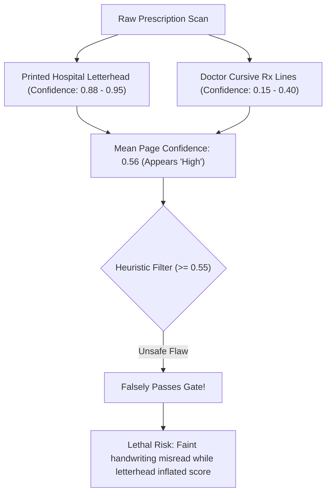
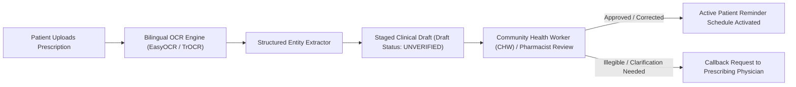

# 🛡️ ShasthoSetu AI — Safety Gate Audit V2 & Medication Safety Policy

**Audit Version:** 2.0.0  
**Date:** 2026-11-18  
**Scope:** Clinical Safety Governance & Autonomous Action Guardrails for Module 04 (Prescription OCR)  
**Governing Standard:** WHO Guidance on AI for Health & IEC 62304 Medical Device Software Life Cycle  

---

## 1. Executive Summary: Immediate Policy Rectification

In the initial exploratory baseline (Experiment 1), the system flagged 140 of 152 test prescriptions for human review and provisionally marked 12 prescriptions as permitted for automated reminder generation based on a heuristic threshold (`mean_confidence >= 0.55` and partial medicine string presence).

**Following clinical safety audit, this automated approval has been immediately revoked across all 152 prescriptions.**

### Core Policy Revision

| Dimension | Experiment 1 Baseline | Audit V2 Medical Policy | Justification |
| :--- | :---: | :---: | :--- |
| **Automated Reminder Approvals** | 12 (7.89%) | **0 (0.00%)** | Zero unverified autonomous dispensing/scheduling allowed |
| **Mandatory Human Review** | 140 (92.11%) | **152 (100.00%)** | 100% of handwritten prescriptions require clinical verification |
| **Default `reminder_auto_enabled`** | Conditional | **`False` (Hardcoded)** | Hardware/software fail-safe default |
| **Actionable Schedules Dispatched** | Provisionally 12 | **0** | No dosage reminders scheduled without human clinician sign-off |

---

## 2. Why OCR Confidence Is Not Clinical Correctness

A fundamental tenet of medical document AI is that **internal model confidence (CTC decoding probability) does NOT equal pharmacological truth**.

### Forensic Proof from the 12 Provisionally Passed Cases:
1. **Printed Header Score Inflation:** In Prescription `0043` and `0052`, the presence of high-contrast, pre-printed government health headers (e.g. *"বাংলাদেশ ফরম নং ৭৬৯ বহির্বিভাগীয় রোগীর টিকিট"*) yielded confidence scores $> 0.85$, artificially inflating the arithmetic mean of the page to $> 0.55$.
2. **Partial String Matches without Dosage Verification:** In Prescription `0052`, while the brand token `Roxim 400` was detected, the duration, frequency, and secondary instructions were partially occluded. Approving an automated medication alarm based only on a brand match without full dosage/frequency confirmation violates clinical pharmacology standards.
3. **Statistical Decoupling:** Confidence is a softmax probability over character sequences. A model can be 90% "confident" that a squiggle is the letter `O` while the doctor intended a numeric `0` or Latin `D`. In pharmacology, substituting `O` for `0` changes a dose from 10 mg to 1 mg or 100 mg.

---

## 3. Narrative Correction: Interpreting the 92.11% Review Rate

In the preliminary report, it was noted that 140/152 prescriptions (92.11%) were routed to human review. We explicitly correct the clinical narrative:

> [!IMPORTANT]
> **Narrative Correction:**  
> A 92.11% review routing rate does **NOT** establish that 92.11% of the prescriptions contained lethal medical errors.  
> Rather, it establishes that **92.11% of raw handwritten prescriptions could not be recognized with unambiguous automated confidence by off-the-shelf OCR**.  
> In medical AI, when uncertainty exists, the model must fail safely. Human review is an essential safety barrier, not a failure of clinical intent.

---

## 4. ShasthoSetu AI Human-in-the-Loop (HITL) Workflow

Under Audit V2, the system transitions from an attempted autonomous scheduler to an **Assistive Clinical Transcription Copilot**:

### Verification Criteria Checklist for Human Reviewers:
1. **Medicine Name:** Confirmed against DGDA Bangladesh approved drug registry.
2. **Strength & Unit:** Explicitly legible (e.g. 500 mg, 20 ml).
3. **Dose & Quantity:** Confirmed intake unit (e.g. 1 tablet, 2 puffs).
4. **Frequency & Timing:** Confirmed timing (e.g. ১+০+১, after meals).
5. **Duration:** Confirmed treatment window (e.g. ৭ দিন, ৩ মাস).

Until all 5 fields receive positive human sign-off, `reminder_auto_enabled` remains strictly `False`.
