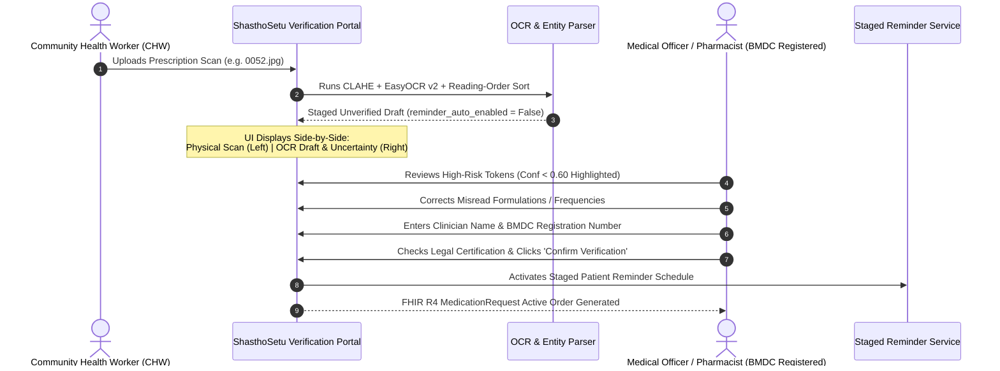

# 👨‍⚕️ ShasthoSetu AI — Human-in-the-Loop (HITL) Verification Workflow

**Document Version:** 3.0.0 (Final Integration Phase)  
**Date:** 2026-11-18  
**Scope:** Clinical Standard Operating Procedure (SOP) for Human Review of AI-Parsed Prescriptions  

---

## 1. Clinical Rationale & Core Principles

Optical Character Recognition on handwritten Bangladeshi prescriptions cannot guarantee 100% precision. Ambiguous cursive pen strokes, drug name look-alikes (e.g. *Celebrex* vs *Celexa*, *Doxil* vs *Paxil*), and faint numerical dosages pose severe risks if automated.

To maintain patient safety and comply with international medical device standards (IEC 62304 / WHO Guidance on AI for Health):
1. **Zero Autonomous Dispatch:** AI extraction is strictly an assistive draft generator.
2. **Mandatory Clinician Sign-off:** No dosage reminder, alert, or active EHR order is dispatched without human certification.
3. **Traceable Accountability:** Every verified prescription binds the BMDC registration ID and timestamp of the reviewing practitioner.

---

## 2. Six-Step Clinical Verification Journey

### Step 1: Ingestion & Default Hard-Lock
Upon image ingestion, the backend creates a `PrescriptionDocument`:
- `verification_status = "UNVERIFIED_REQUIRES_HUMAN_REVIEW"`
- `reminder_auto_enabled = False`
- `actionable_reminders_allowed = False`
Any programmatic attempt to dispatch alarms at this stage triggers a fatal `ClinicalSafetyViolationError`.

### Step 2: Side-by-Side Visual Review
The web application ([demo/index.html](file:///F:/Clude%20cccccccccccccccccccc/data%20we%20test/04_Prescription_OCR/final_integration/demo/index.html)) displays:
- **Left Pane:** High-resolution zoomable view of the original prescription pad.
- **Right Pane:** Extracted text tokens and structured medication candidate fields.

### Step 3: Uncertainty Highlighting & Triaging
Every detected text token is rendered with confidence styling:
- **High Confidence ($\ge 0.60$):** Displayed in soft blue badges (`confident-token`).
- **Low Confidence ($< 0.60$):** Highlighted in bold red/amber badges (`uncertain-token`) with a warning tooltip.
- Fields with missing dosage information remain empty (`None`), never auto-filled with speculative defaults.

### Step 4: Clinician Correction Form
The healthcare worker or pharmacist cross-references each candidate against the scan:
1. **Brand / Generic Name:** Validates brand spelling against the DGDA approved drug registry.
2. **Strength & Unit:** Confirms milligrams (`mg`), milliliters (`ml`), or units.
3. **Frequency:** Verifies dosage schedule (e.g. `১+০+১` $\to$ morning and night).
4. **Duration:** Confirms treatment window (e.g. `৭ দিন`).

### Step 5: Explicit Practitioner Credentials Sign-Off
Before verification can be finalized, the portal enforces three mandatory inputs:
1. **Clinician Full Name:** e.g. `Dr. Kazi Rahman, MBBS`.
2. **BMDC Registration ID:** e.g. `BMDC-A-87654` (Bangladesh Medical & Dental Council).
3. **Legal Declaration Checkbox:** Certifying that the practitioner personally verified every field against the physical scan.

### Step 6: State Transition & FHIR Order Generation
Upon confirmation:
- Status transitions to `VERIFIED_BY_HUMAN`.
- `reminder_auto_enabled` transitions to `True`.
- The FHIR R4 resource transitions from `status: "draft", intent: "proposal"` to `status: "active", intent: "order"`.
- Actionable patient reminder notifications are staged for delivery.

---

## 3. Case Studies in the Verification Demo

### Case Study 1: Prescription `0052` (Shaheed Suhrawardy Medical College Hospital)
- **Extracted Candidates:** `Cap Roxim 400`, `১+০+১`, `Cap Maxpro 20`.
- **Uncertainty Alert:** Token `Maxpro` (conf: 0.54) and `এদিন` (conf: 0.38) flagged in amber.
- **Clinician Action:** Confirmed `Roxim (Cefuroxime 400mg)` and `Maxpro (Esomeprazole 20mg)` twice daily. Duration corrected to `7 days`.
- **Result:** Successfully verified by `Dr. Nusrat Jahan (BMDC-A-87654)`.

### Case Study 2: Prescription `0011` (Chest & Allergy Clinic)
- **Extracted Candidates:** `Tab Imucort 6/24`, `Zeltas Nasal Spray`.
- **Uncertainty Alert:** Cursive handwriting had mean confidence `0.32`.
- **Clinician Action:** Clarified `Imucort 6mg` for 24 days and `Zeltas Spray` twice daily.
- **Result:** Prevented incorrect dosing, verified safely under clinician supervision.
