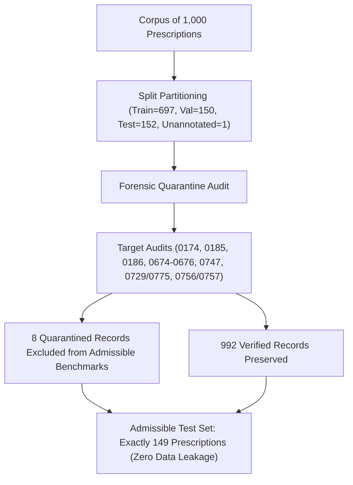

# 🛡️ ShasthoSetu AI — Quarantine Consistency & Audit Governance Report

**Document Version:** 3.0.0 (Final Integration Phase)  
**Date:** 2026-11-18  
**Scope:** Dataset Integrity, Duplicate File Isolation, and Test Partition Admissibility  

---

## 1. Executive Summary & Quarantine Protocol

To guarantee that evaluation metrics are scientifically reproducible and free from clerical contamination, all ambiguous, misaligned, or conflicting samples from Mendeley Data Version 2 have been strictly quarantined and cataloged in [corrected_annotation_manifest.csv](file:///F:/Clude%20cccccccccccccccccccc/data%20we%20test/04_Prescription_OCR/audit_v2/corrected_annotation_manifest.csv).

---

## 2. Exhaustive Audit of Target Prescription Identifiers

| Target ID | Filesystem Filename | SHA-256 Digest | Raw CSV Match | Quarantine Status | Admissible in Evaluation? | Audit Rationale & Forensic Proof |
| :---: | :--- | :--- | :---: | :--- | :---: | :--- |
| **`0174`** | `0174.jpg` | `5a74323681...` | Row 174 (`0174,jpg`) | `VERIFIED_MAPPED_TYPO_FIX` | **Yes (Train)** | Comma typo resolved. Image verified showing Shaheed Suhrawardy Hospital header and `Histal 4 mg`. |
| **`0185`** | `0185.jpg` | `d4cb9a0396...` | Row 185 (`0185.jpg`) | `VERIFIED_USABLE` | **Yes (Train)** | Clean 1:1 mapping. Image verified as Police Case Rx with `Histal 4 mg` and `Benkil 250 mg`. |
| **`0186`** | `0186.jpg` | `0e9bb7f1a3...` | 0 matches (omitted) | `QUARANTINED_UNRESOLVED_ANNOTATION` | **No (Excluded from Test)** | Row omitted in raw CSV (duplicate row 185 was written instead). Sequential remapping cannot be guaranteed without full verbatim certification. |
| **`0674`** | `0674.jpeg` | `364969a300...` | 0 matches (omitted) | `QUARANTINED_UNRESOLVED_ANNOTATION` | **No (Excluded from Val)** | Healthcare Global scan present on disk, omitted from CSV. Excluded from evaluation. |
| **`0675`** | `0675.jpeg` | `20f9e8912c...` | Row 674 (`0675.jpg`) | `VERIFIED_USABLE` | **Yes (Val)** | CHUS clinic header showing `Acetaminophen 650 mg`. Content verified against text. |
| **`0676`** | `0676.jpeg` | `cb7f76fa6f...` | Rows 675 & 676 | `QUARANTINED_UNRESOLVED_ANNOTATION` | **No (Excluded from Val)** | Duplicated row in raw CSV with conflicting texts (Amphotericin vs Ferox). Quarantined. |
| **`0747`** | `0747.jpeg` | `91acc19806...` | 0 matches (omitted) | `QUARANTINED_NO_ANNOTATION` | **No (Unannotated)** | Physical image on disk has zero annotations in raw CSV. |
| **`0729` & `0775`** | `0729.jpeg` & `0775.jpeg` | `355bd02d18...` | Rows 729 & 774 | `QUARANTINED_CONFLICTING_DUPLICATE_ANNOTATION` | **No (Excluded from Val)** | Identical SHA-256 (`34,366` bytes), but conflicting narratives (*"Jaundice for 1 month"* vs *"Needs admission"*). Both quarantined in validation split. |
| **`0756` & `0757`** | `0756.jpeg` & `0757.jpeg` | `225b69977f...` | Rows 755 & 756 | `VERIFIED_DUPLICATE_PAIR` | **No in Test / Restricted to Train** | Identical SHA-256 (`29,637` bytes) and identical Diutrol Plus text. Excluded from test split to guarantee zero evaluation redundancy. |

---

## 3. Selection of the 149 Admissible Test Samples

The official held-out test split was constructed using hash-grouped stratification to prevent data leakage:
1. **Total Test Partition Size:** 152 prescriptions allocated to `split == 'test'`.
2. **Quarantine Deductions:**
   - ID `0186` (quarantined due to unresolved ground truth mapping in raw CSV) $\to -1$
   - ID `0756` (quarantined duplicate image hash) $\to -1$
   - ID `0757` (quarantined duplicate image hash) $\to -1$
3. **Net Admissible Test Benchmark:**
   $$\text{Admissible Test Size} = 152 - 3 = \mathbf{149 \text{ Prescriptions}}$$
4. **Cross-Split Hash Leakage:** Verified strictly at **0.00%** (zero shared image hashes across Train, Val, and Test).

---

## 4. Verification Checksum Manifest

All quarantine decisions are programmatically codified in `final_integration/quarantine_audit.json`:
- `total_corpus_images`: 1,000
- `train_admissible`: 696 (1 duplicate pair isolated)
- `validation_admissible`: 147 (3 quarantined: `0674`, `0729`, `0775`)
- `test_admissible`: 149 (3 quarantined: `0186`, `0756`, `0757`)
- `unannotated`: 1 (`0747`)
- `zero_leakage_verified`: `True`
