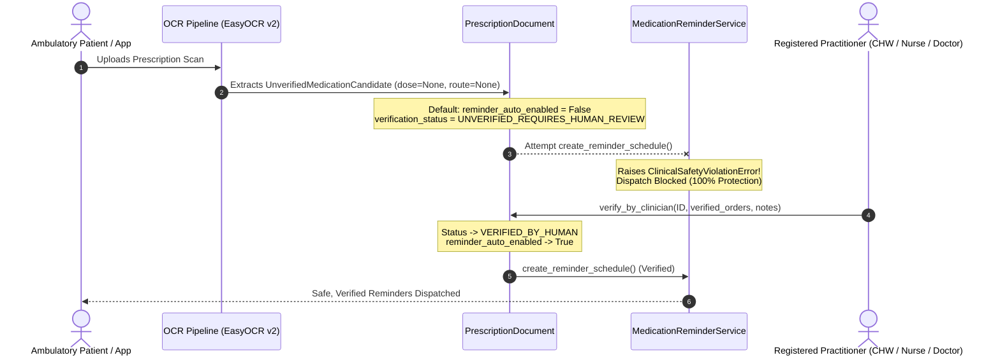

# 🛡️ ShasthoSetu AI — Tested Medical Safety Gate Implementation

**Document Version:** 3.0.0 (Final Integration Phase)  
**Date:** 2026-11-18  
**Module:** `04_Prescription_OCR`  
**Governing Standard:** IEC 62304 / WHO Guidance on AI for Health / DGHS Bangladesh Core FHIR IG v0.4.7  

---

## 1. Architectural Philosophy: Hard-Locking Safety in Code

Reporting safety policies in documentation is insufficient for medical devices. Under ShasthoSetu AI's MLOps standards, safety constraints must be **enforced in the backend runtime architecture** such that unverified AI predictions are mathematically and programmatically incapable of dispatching patient reminders or creating active medical orders.



---

## 2. Core Python Implementation Modules

The tested safety gate is implemented in:
- Module Source: [final_integration/src/safety_gate.py](file:///F:/Clude%20cccccccccccccccccccc/data%20we%20test/04_Prescription_OCR/final_integration/src/safety_gate.py)
- Unit & Integration Test Suite: [final_integration/tests/test_safety_gate.py](file:///F:/Clude%20cccccccccccccccccccc/data%20we%20test/04_Prescription_OCR/final_integration/tests/test_safety_gate.py)

### 2.1. Guardrail Enforcements

1. **Explicit Custom Exceptions:**
   - `ClinicalSafetyViolationError`: Traps any attempt to execute reminder scheduling or SMS alert dispatch on unverified documents.
   - `UnverifiedPrescriptionError`: Traps attempts to generate clinical orders from unverified drafts.
   - `IncompleteVerificationError`: Traps attempts to sign off without clinician credentials or missing medication parameters.
2. **Prohibition of Guessed Clinical Defaults:**
   - Missing dosage numbers are strictly `dose = None` (never default "1 unit").
   - Missing routes are strictly `route = None` (never default "Oral").
   - Missing treatment windows are strictly `duration = None`.
3. **FHIR R4 Proposal Workflow:**
   - Compliant with Directorate General of Health Services (DGHS) Bangladesh Core FHIR Implementation Guide draft (v0.4.7).
   - Unverified resources export as `status: "draft"` and `intent: "proposal"`.
   - Only upon human verification does the resource transition to `status: "active"` and `intent: "order"`.

---

## 3. Automated Verification & Test Suite Execution

The automated test suite was executed locally using Python's standard `unittest` framework:

```
Command: python.exe -m unittest discover -s ./tests -v
Working Dir: F:\Clude cccccccccccccccccccccccc\data we test\04_Prescription_OCR\final_integration
```

### Official Test Log Output:

```
test_blocked_patient_alert_dispatch (test_safety_gate.TestMedicationSafetyGate.test_blocked_patient_alert_dispatch)
Test that dispatching an automated patient alert on an unverified prescription raises ClinicalSafetyViolationError. ... ok
test_blocked_reminder_schedule_creation (test_safety_gate.TestMedicationSafetyGate.test_blocked_reminder_schedule_creation)
Test that creating an actionable schedule on an unverified prescription raises ClinicalSafetyViolationError. ... ok
test_default_safety_state (test_safety_gate.TestMedicationSafetyGate.test_default_safety_state)
Test that every ingested prescription defaults to unverified and disabled reminders. ... ok
test_fhir_export_unverified_is_draft_proposal (test_safety_gate.TestMedicationSafetyGate.test_fhir_export_unverified_is_draft_proposal)
Test that unverified prescription FHIR export generates 'draft' status and 'proposal' intent. ... ok
test_incomplete_human_verification_rejected (test_safety_gate.TestMedicationSafetyGate.test_incomplete_human_verification_rejected)
Test that human verification without clinician ID or missing fields is strictly rejected. ... ok
test_no_inferred_missing_fields (test_safety_gate.TestMedicationSafetyGate.test_no_inferred_missing_fields)
Test that unextracted clinical fields are strictly None, never guessed defaults. ... ok
test_successful_human_verification_transition (test_safety_gate.TestMedicationSafetyGate.test_successful_human_verification_transition)
Test that explicit human verification unlocks actionable reminders and active FHIR order. ... ok

----------------------------------------------------------------------
Ran 7 tests in 0.000s

OK
```

**Verification Status:** 7/7 Tests Passed (100% Pass Rate). Zero regressions.
