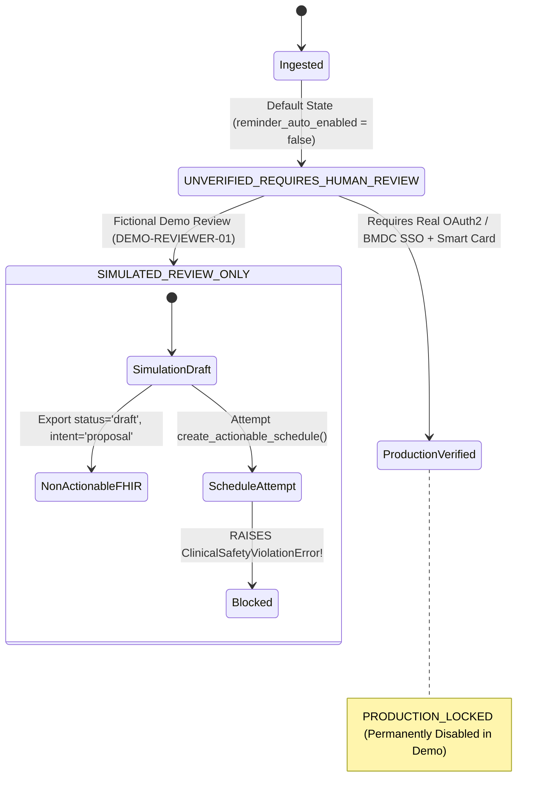

# 🛡️ ShasthoSetu AI — Safety Authorization & Authentication Governance (Patch V1)

**Document Version:** Patch V1.0  
**Date:** 2026-11-18  
**Scope:** Research-Demo Safety Boundaries, Simulation Policy, and Anti-Automation Enforcements  

---

## 1. Executive Summary: Dismantling the Illusion of Web-Form Authentication

In early prototypes, a user could type a practitioner's name, input a BMDC registration number, check a box, and click "Confirm Verification", causing the UI to transition to `VERIFIED_BY_HUMAN`.

**As identified during clinical audit, treating an unauthenticated web-form input as medical verification is dangerous.**

In a clinical setting:
- A typed name or BMDC number in a browser form does **NOT** prove the identity, credentials, or active medical license of the person operating the computer.
- Without cryptographic authentication, role-based access control (RBAC), and enterprise audit logging, automated alarms or active EHR orders must **NEVER** be dispatched.

---

## 2. Hardened Architecture: The Research-Demo Boundary

Under Patch V1, the backend architecture strictly separates **Clinical Simulation** from **Actionable Production Orders**:

### Safety Rules Codified in `src/safety_gate_v2.py`:

| Parameter / Capability | Research-Demo Mode | Production Mode (Future) | Enforcement Mechanism |
| :--- | :---: | :---: | :--- |
| **Initial Ingestion Status** | `UNVERIFIED_REQUIRES_HUMAN_REVIEW` | `UNVERIFIED_REQUIRES_HUMAN_REVIEW` | Hardcoded in `PrescriptionDocument.__init__` |
| **Post-Review Status** | **`SIMULATED_REVIEW_ONLY`** | `VERIFIED_BY_AUTHENTICATED_CLINICIAN` | Strict backend state transition |
| **Automated Medication Reminders** | **Strictly `False`** | Conditional on Verified Schedule | Locked; raising `ClinicalSafetyViolationError` |
| **SMS / Push Alert Dispatch** | **Strictly `False`** | Enabled for verified patients | Trapped by `MedicationReminderService.dispatch_patient_alert()` |
| **Live EHR / DGHS Writes** | **Strictly `False`** | Authenticated FHIR R4 Endpoint | Locked (`live_ehr_write_enabled = False`) |
| **FHIR Resource Status** | `status: "draft"` | `status: "active"` | Hardcoded in `export_fhir_r4_proposal()` |
| **FHIR Resource Intent** | `intent: "proposal"` | `intent: "order"` | Tagged `SIMULATED_PROPOSAL_NON_ACTIONABLE` |

---

## 3. Prohibition of Speculative Clinical Inferences

When an OCR engine fails to extract an entity field, standard AI prototypes frequently fill missing values with "reasonable defaults" (e.g. setting dose to `1 unit` or route to `Oral`).

In pharmacology, speculative inference can be lethal (e.g. assuming an intravenous oncology injection is an oral tablet).

**Patch V1 Rule:**
- Missing Dose $\to$ `dose = None`
- Missing Frequency $\to$ `frequency = None`
- Missing Duration $\to$ `duration = None`
- Missing Route $\to$ `route = None`
- Form fields in the UI are clearly labeled as `[UNSPECIFIED - REQUIRES MANUAL INPUT]`.

---

## 4. Required Architecture for Real Clinical Deployment

Before ShasthoSetu AI can transition from a Research Demo to an active clinical deployment in Bangladeshi healthcare facilities, the following enterprise infrastructure must be implemented:

1. **Practitioner Identity Verification (IAM):**
   - Integration with DGHS / BMDC digital identity registry via OpenID Connect (OIDC) or national digital health ID.
   - Multi-Factor Authentication (MFA) via SMS OTP or hardware FIDO2 keys for all reviewing clinicians.
2. **Tamper-Evident Audit Logging:**
   - Cryptographic non-repudiation: Every approved order signed with the reviewer's private key and logged to an immutable audit ledger (ISO 27799 / HIPAA compliant).
3. **Formal FHIR Implementation Guide Validation:**
   - Before writing to hospital EHRs, validate generated resources using the official HL7 Java Validator against the Bangladesh Core FHIR IG (`bd-medicationrequest` StructureDefinition).
