<div align="center">

# 🩺 ShasthoSetu AI (স্বাস্থ্যসেতু এআই)

### Offline-First Bilingual Clinical Intelligence, 3D Medical Care Twin, Hybrid RAG & Telemedicine Operating System for Bangladesh

[](https://www.python.org/)
[](API.md)
[](apps/web)
[](docs/ARCHITECTURE.md)
[-10B981?style=for-the-badge&logo=pytest&logoColor=white)](docs/TESTING.md)
[](docs/mcp_architecture.md)
[](https://huggingface.co/datasets/ashik1236/shasthosetu-clinical-datasets)
[](#4-key-capabilities--clinical-safety-engineering)
[](LICENSE)

> **Research & Prototype Notice:** ShasthoSetu AI is an open-source research and interactive telemedicine engineering platform. Every diagnostic ML score, triage rule, and OCR check is strictly **non-diagnostic and human-verified** under licensed clinician oversight.

</div>

---

## 📑 Table of Contents

- [1. Executive Overview & Healthcare Mission](#1-executive-overview--healthcare-mission)
- [2. Verified Platform Metrics (In Numbers)](#2-verified-platform-metrics-in-numbers)
- [3. Visual Product Tour & Verified Execution Evidence](#3-visual-product-tour--verified-execution-evidence)
- [4. Key Capabilities & Clinical Safety Engineering](#4-key-capabilities--clinical-safety-engineering)
- [5. System Architecture & Engineering Pipelines](#5-system-architecture--engineering-pipelines)
- [6. Audited AI Models, Benchmarks & Honest Disclosures](#6-audited-ai-models-benchmarks--honest-disclosures)
- [7. 10-Minute Local Quickstart](#7-10-minute-local-quickstart)
- [8. Demo Accounts & 5-Minute Evaluation Flow](#8-demo-accounts--5-minute-evaluation-flow)
- [9. Automated Testing & Verification Summary](#9-automated-testing--verification-summary)
- [10. Repository Directory Architecture](#10-repository-directory-architecture)
- [11. Complete A–Z Documentation Index](#11-complete-a-z-documentation-index)
- [12. Official Engineering Team](#12-official-engineering-team)
- [13. Attribution & License](#13-attribution--license)

---

## 1. Executive Overview & Healthcare Mission

Across Bangladesh's **170+ million citizens**, district hospitals and rural Upazila Health Complexes face severe clinician shortages, unstandardized handwritten prescriptions, fragmented emergency blood coordination, and linguistic barriers when medical tools support only English. Generic cloud chatbots hallucinate medication dosages, transmit sensitive health context off-device, and fail to handle code-switched Bengali ("Banglish") queries or rural network instability.

**ShasthoSetu AI (স্বাস্থ্যসেতু এআই)** solves these gaps with an **offline-first, local-edge clinical intelligence and telemedicine platform**:

1. **Local-First Edge Inference & Storage:** Runs `Qwen 2.5 7B`, `bge-m3` embeddings, `Whisper` Bengali/English ASR, and **55-table SQLite WAL** storage directly on local hardware via Ollama (`:11434`) and FastAPI (`:8000`) — zero mandatory cloud vendor lock-in.
2. **Evidence-Grounded Clinical Triage:** Hybrid retrieval (**BM25Okapi + BGE-M3 + Knowledge Graph RRF**) retrieves locked DGHS Bangladesh & WHO reference chunks (`Recall@1: 95.00%`, `Recall@3: 100.00%`, `MRR: 0.9750`) with immediate **Code 999** emergency escalation and prompt-injection refusal.
3. **Human-in-the-Loop Safe-OCR Gate (`HTTP 422`):** Bilingual prescription extraction (`EasyOCR ['bn','en']`) refuses automated medication reminder activation until a patient or verified clinician reviews uncertain handwritten tokens.
4. **4-Role Telemedicine & Emergency Care Ecosystem:** Physically and cryptographically separates **Patient**, **Approved/Pending Doctor**, **Zero-PHI Support Desk**, and **System Admin** workspaces across 8 divisions of Bangladesh.

---

## 2. Verified Platform Metrics (In Numbers)

| Metric Category | Verified Scope / Score | Ground Truth Reference |
| :--- | :--- | :--- |
| **Backend API Surface** | **139 endpoints** across **15 FastAPI routers** | [`services/api/src/shasthosetu_api/routers/`](services/api/src/shasthosetu_api/routers) |
| **Operational Database** | **55 SQLite tables** (`WAL` mode + `BEGIN IMMEDIATE` locks) | [`services/api/src/shasthosetu_api/db/schema.sql`](services/api/src/shasthosetu_api/db/schema.sql) |
| **Clinician & Geo Coverage** | **43 approved clinicians**, **8 departments**, **8 Bangladesh divisions** | [`apps/web/src/components/map/BangladeshCareMap.tsx`](apps/web/src/components/map/BangladeshCareMap.tsx) |
| **Hybrid RRF Clinical RAG** | **Recall@1: 95.00%**, **Recall@3: 100.00%**, **MRR: 0.9750** ($N=20$ medical) | [`docs/evidence/AI_RAG_VOICE_OCR_01/rag_eval_table.md`](docs/evidence/AI_RAG_VOICE_OCR_01/rag_eval_table.md) |
| **Audited ML / DL Modules** | **6 clinical research prototypes** (SHA-256 hash-locked) | [`FINAL_AUDIT_SIGNOFF.md`](SHASTHOSETU_FINAL_DATASET_MODEL_AUDIT/final_lock/FINAL_AUDIT_SIGNOFF.md) |
| **MCP Server Ecosystem** | **3 custom built** + **3 local public** + **1 remote SSE** (`7` configured) | [`docs/mcp_architecture.md`](docs/mcp_architecture.md) |
| **Hugging Face Data Archive** | **35,641 files** (~2.03 GiB) across 7 audited dataset folders | [`huggingface.co/datasets/ashik1236/shasthosetu-clinical-datasets`](https://huggingface.co/datasets/ashik1236/shasthosetu-clinical-datasets) |
| **Automated Test Suites** | **53/53 tests passing** (**38 pytest** + **15 vitest**) + `tsc --noEmit` | [`docs/TESTING.md`](docs/TESTING.md) |

---

## 3. Visual Product Tour & Verified Execution Evidence

Every screenshot below captures genuine execution of the local ShasthoSetu AI stack across desktop and role-isolated portals:

<table>
  <tr>
    <td width="50%">
      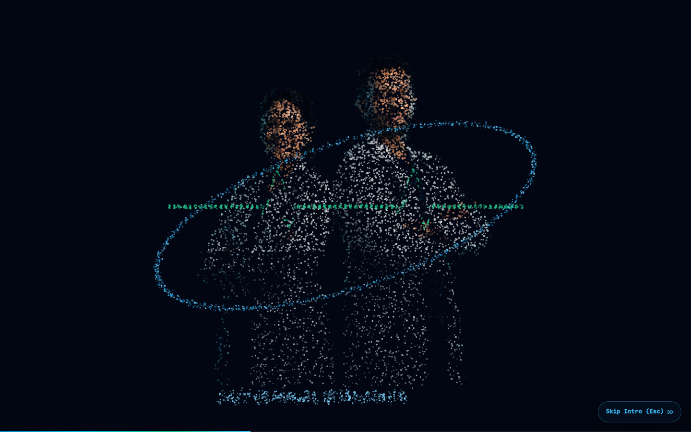
      <br/><sub><b>1. Sapphire Landing &amp; 3D Care Twin.</b> Interactive Three.js holographic showcase, Bilingual EN/বাংলা toggle, White/Dark Daylight Mode, and chapter scroll navigation.</sub>
    </td>
    <td width="50%">
      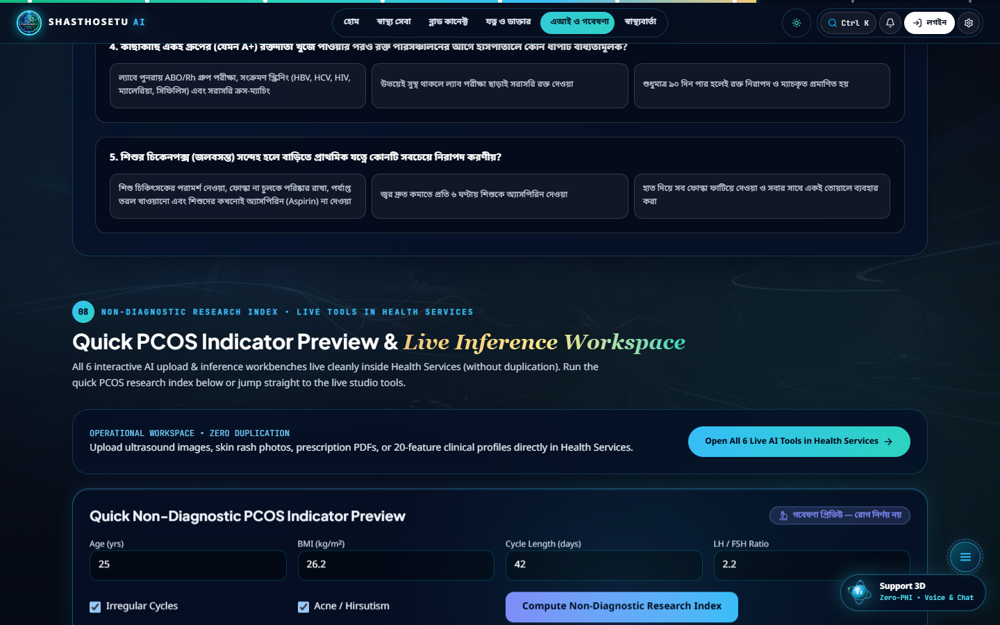
      <br/><sub><b>2. AI &amp; Research Observatory.</b> Live LangGraph workflow visualization, 6 audited clinical models, dataset provenance dossiers, and interactive MCP Explorer.</sub>
    </td>
  </tr>
  <tr>
    <td width="50%">
      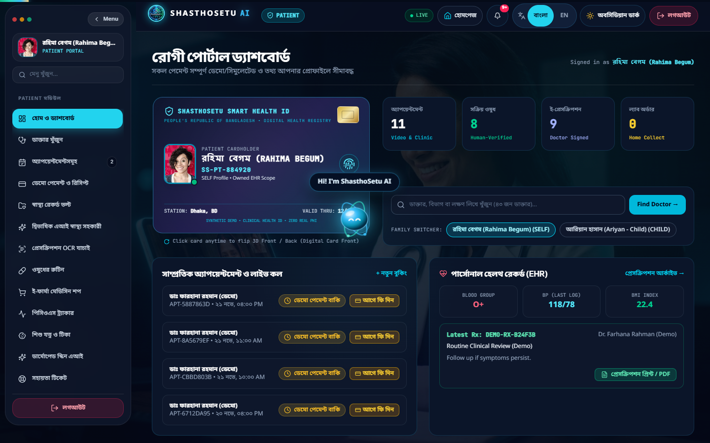
      <br/><sub><b>3. Patient Portal, ePharma &amp; Diagnostic Panels.</b> Cycle tracker, verified prescriptions, 12 diagnostic lab panels, medicine cart, and simulated checkout receipts.</sub>
    </td>
    <td width="50%">
      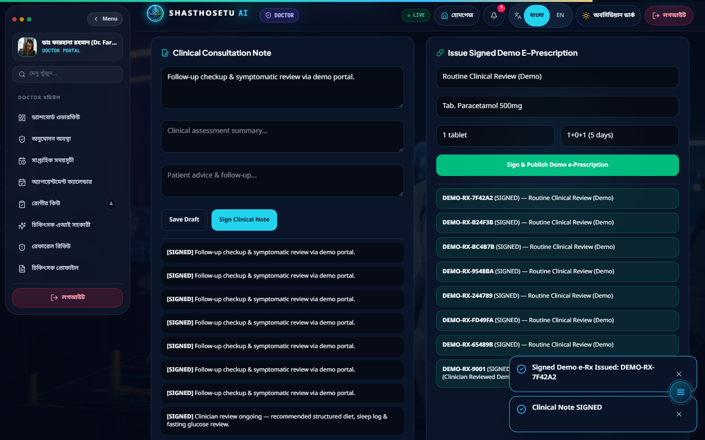
      <br/><sub><b>4. Doctor Workspace &amp; 2-Device Teleconsultation.</b> Approved BMDC clinician queue, SOAP clinical notes, signed e-Prescriptions, and WebRTC consultation room.</sub>
    </td>
  </tr>
  <tr>
    <td width="50%">
      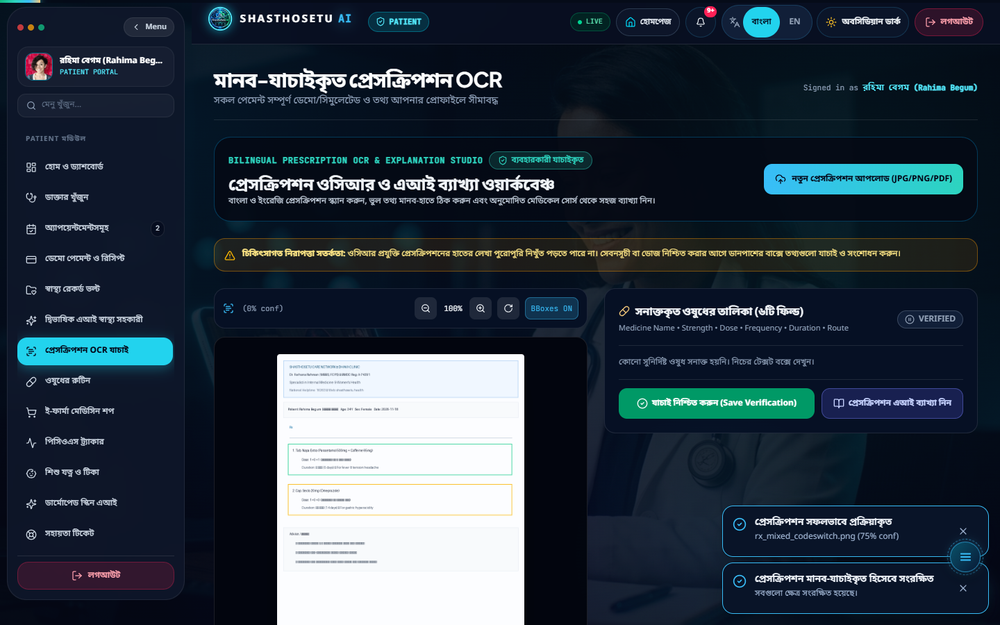
      <br/><sub><b>5. Safe-OCR Human Verification Gate (HTTP 422).</b> Highlights low-confidence medicine tokens and locks automated reminders until confirmed by patient or physician.</sub>
    </td>
    <td width="50%">
      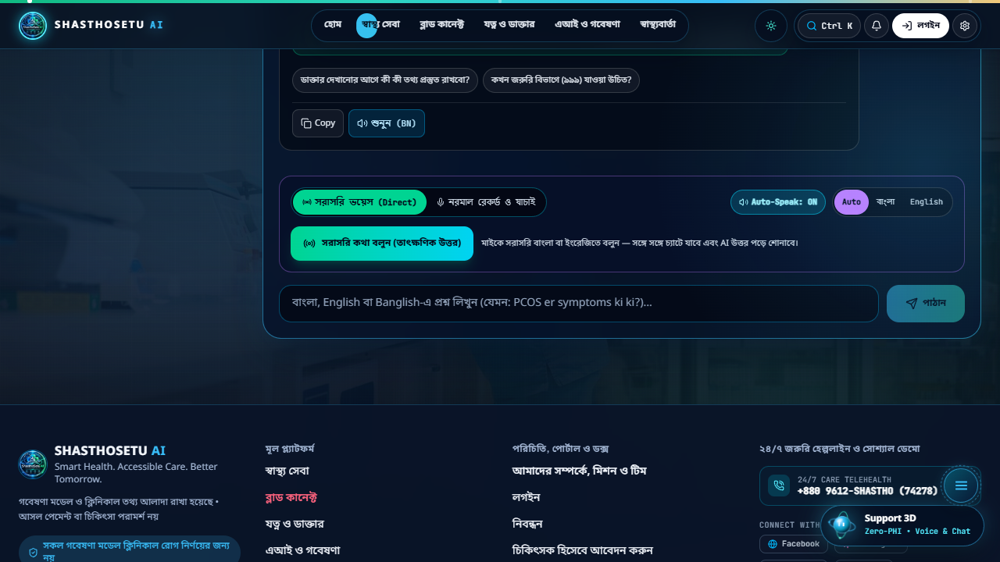
      <br/><sub><b>6. Bilingual Hybrid RAG &amp; Dual-Mode Voice Assistant.</b> Supports direct hands-free voice call mode and text chat with on-demand Listen (শুনুন) TTS + citation drawer.</sub>
    </td>
  </tr>
  <tr>
    <td width="50%">
      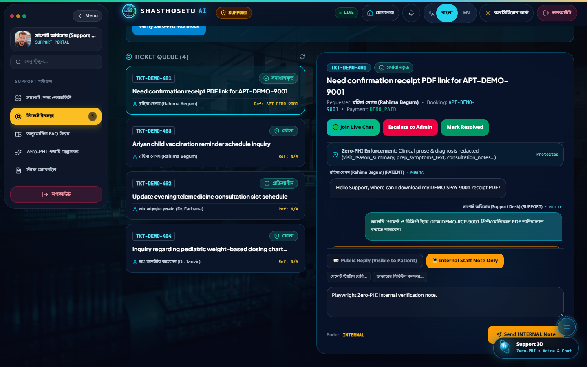
      <br/><sub><b>7. Heuristic Zero-PHI Support Desk Isolation.</b> Non-clinical staff handle ticket queues cleanly while private clinical notes &amp; diagnostic payloads enforce <code>HTTP 403</code>.</sub>
    </td>
    <td width="50%">
      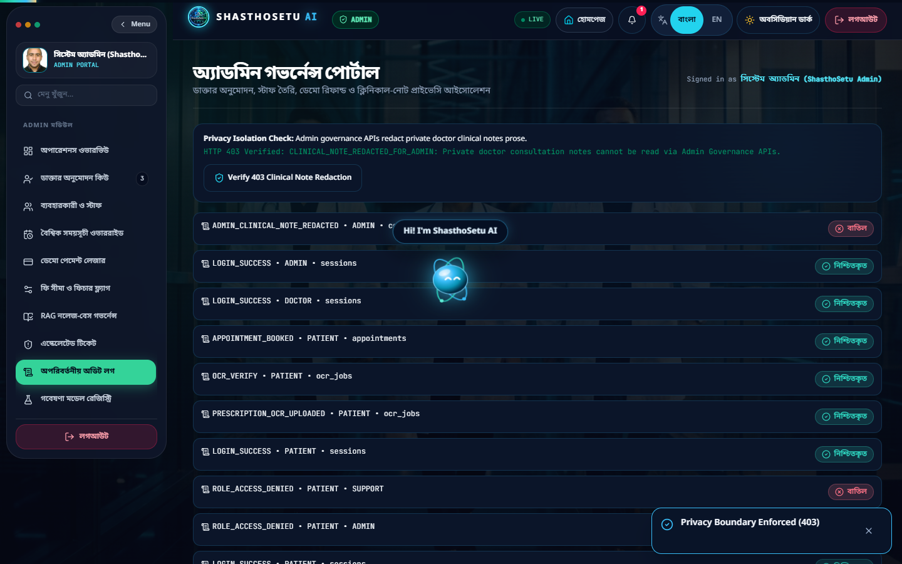
      <br/><sub><b>8. System Admin Governance &amp; Audit Logs.</b> Doctor onboarding approval workflow, RAG corpus indexing controls, and immutable security audit telemetry.</sub>
    </td>
  </tr>
</table>

---

## 4. Key Capabilities & Clinical Safety Engineering

1. **Bilingual Hybrid RAG & Dual-Mode Voice AI (`bn` / `en` / Banglish):**
   - **Mode 1 — Hands-Free Live Voice Call:** Direct microphone streaming via Web Audio Analyser with `Whisper-v3-turbo` / `whisper-small-bn` ASR, editable transcript confirmation gate, and automatic spoken replies.
   - **Mode 2 — Interactive Text Chat + On-Demand Listen (`শুনুন`):** Instant grounded replies citing DGHS/WHO documents with one-click voice playback.
2. **Emergency Code 999 & Prompt-Injection Guardrails (`safety_guard.py`):**
   - Sub-200 ms interception of acute chest pain, dyspnea, stroke, convulsions, or pediatric danger signs, immediately surfacing emergency 999 hotline escalation and refusing unsafe prescribing requests.
3. **Human-in-the-Loop Safe-OCR Prescription Gate (`HTTP 422`):**
   - Parses Bengali + English prescriptions via `EasyOCR`, tracks uncertain token confidence, and blocks unverified automated medication reminders (`HTTP 422`) until human review (`PATIENT_ACKNOWLEDGED_REMINDER` or `CLINICIAN_VERIFIED`).
4. **3D Medical Care Twin, Gyroscopic Chatbot Orb & Daylight Mode:**
   - Interactive Three.js Care Lattice & Holographic Body Scanner, 60 FPS cursor-tracking gyroscopic `MedicalAiChatbotOrb` with radial Quick-Team & GitHub menu, and high-contrast **Clinical Daylight White Mode** alongside Sapphire Obsidian Dark Mode.
5. **Emergency Blood Connect & 2-Device WebRTC Telemedicine:**
   - All 8 administrative divisions of Bangladesh (`Dhaka`, `Chattogram`, `Rajshahi`, `Khulna`, `Barishal`, `Sylhet`, `Rangpur`, `Mymensingh`) with geo-radius matching, contact masking (`+880 17•• •••12`), strict **payment-before-call** booking flow, and synced 2-device consultation room (`apt-demo-9001`).
6. **Custom & Public MCP Suite + Multi-Agent Orchestration:**
   - **3 Custom MCP Servers** (`guideline-mcp`, `directory-mcp`, `care-record-mcp`) supporting `stdio`, `sse`, and `streamable-http` transports + **4 Integrated MCPs** (`filesystem`, `memory`, `sequential-thinking`, `cloudcamp-bd`) + live **LangGraph** state-machine triage & cross-framework adapters (**AutoGen**, **CrewAI**, **OpenAI Agents SDK**).

---

## 5. System Architecture & Engineering Pipelines

### 5.1 Six-Layer System Topology

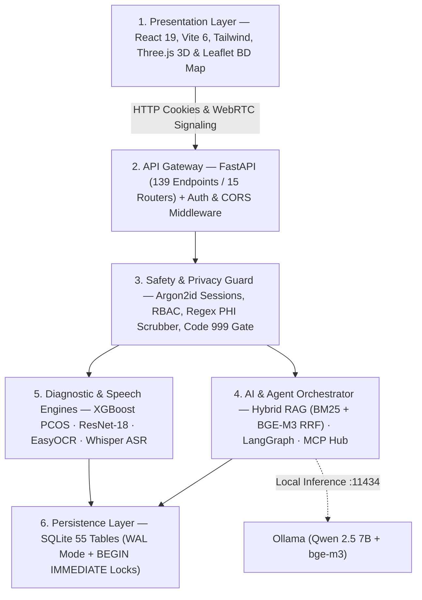

### 5.2 Bilingual Hybrid RAG & Clinical Safety Flow

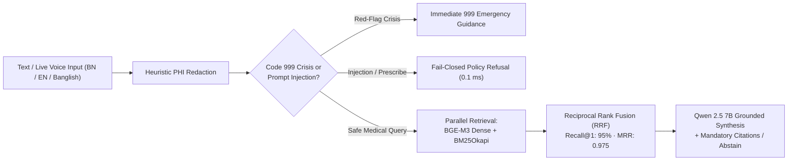

### 5.3 Safe-OCR Medication Activation Gate (`HTTP 422`)

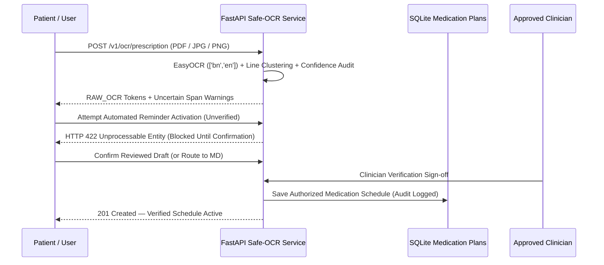

---

## 6. Audited AI Models, Benchmarks & Honest Disclosures

All figures below match the cryptographically frozen register in [`SHASTHOSETU_FINAL_DATASET_MODEL_AUDIT/final_lock/FINAL_AUDIT_SIGNOFF.md`](SHASTHOSETU_FINAL_DATASET_MODEL_AUDIT/final_lock/FINAL_AUDIT_SIGNOFF.md) and evaluation tables in [`docs/evidence/AI_RAG_VOICE_OCR_01/`](docs/evidence/AI_RAG_VOICE_OCR_01).

### 6.1 Six Audited Clinical AI Modules (`RESEARCH_AUDIT_PASS_WITH_LIMITATIONS — FROZEN`)

| Module | Architecture / Role | Audited Benchmark Metric | Mandatory Operational Limitation |
| :--- | :--- | :--- | :--- |
| **01 PCOS Clinical** | XGBoost Tabular Prototype | Held-out Bal Acc: **94.44%** (`17/18`); 50-fold CV: **88.57%** | Small cohort ($N=88$, SHA-256 locked); proxy biomarkers only; non-diagnostic. |
| **02 PCOS Ultrasound** | ResNet-18 B-Mode Morphology | Held-out Test Acc: **86.67%** (`39/45`) | Grouped via perceptual hash (pHash); lacks hospital patient IDs; imaging alone cannot diagnose PCOS. |
| **03 Viral Skin Rash** | ResNet-18 Grouped (`N=755` families) | Val Img Acc: **84.65%**, F1: **84.22%**; Test Family: **85.09%** | Strictly zero-leakage source-photo family split; older 99.10% leaked baseline permanently quarantined; web images lack RT-PCR confirmation. |
| **04 Prescription OCR** | EasyOCR 1.7.2 + Verification Gate | Printed ($N=4$): Prec **77.78%**, Rec **100.0%**, F1 **87.50%**; Smoke `0052.jpg`: **44 tokens** | **Real handwritten CER/WER is `NOT_VALIDATED`** due to absent verbatim transcripts; reminders locked (`HTTP 422` / `SIMULATED_REVIEW_ONLY`). |
| **05 Bangla Voice AI** | Whisper-Small-BN + Base Auto-Route | 26 FLEURS Clips: Norm WER **39.09%**, BN Unicode **98.37%** (`Smoke_Test_6`: 45.56% BN / 8.39% EN) | General-domain speech; requires editable transcript confirmation gate before clinical AI dispatch. |
| **06 DermoPed Skin** | ResNet-18 `EXP_B` / `EXP_D` | Held-out Test Img Acc: **92.73%** (EXP_B; `EXP_D`: 100% on 4 pts) | Local 22-patient subset (`19` Chickenpox, **only `3` Pediculosis** patients); architectural research PoC only. |

### 6.2 Bilingual Hybrid RAG Retrieval Comparison ($N=20$ Medical Queries)

| Retrieval Strategy | Recall@1 | Recall@3 | Recall@5 | MRR | Avg Latency | P95 Latency |
| :--- | :---: | :---: | :---: | :---: | :---: | :---: |
| **Dense Only (`bge-m3`)** | 90.00% | 100.00% | 100.00% | 0.9500 | 215.92 ms | 171.75 ms |
| **BM25Only (`BM25Okapi`)** | 80.00% | 90.00% | 95.00% | 0.8542 | **2.62 ms** | 3.02 ms |
| **Hybrid RRF (Dense + BM25)** | **95.00%** | **100.00%** | **100.00%** | **0.9750** | 141.88 ms | 150.42 ms |

> [!IMPORTANT]
> **Mandatory Medical, Privacy & Regulatory Disclaimers**
> 1. **Non-Diagnostic Research Prototype:** ShasthoSetu AI is NOT a certified medical device and does NOT diagnose conditions or prescribe treatments autonomously. Every clinical summary requires review by a registered physician.
> 2. **Heuristic Privacy Protocol (Not Regulatory Certification):** Regex/token masking (`Zero-PHI` heuristics) and local SQLite WAL storage protect demo workflows, but do not constitute formal HIPAA, GDPR, or Bangladesh Medical & Dental Council (BMDC) regulatory certification.
> 3. **Upstream Dataset Rights & Takedown:** Third-party academic datasets (Mendeley, Zenodo, Google FLEURS) remain under their respective upstream open-access licenses. See [`DATASETS.md`](DATASETS.md) and [`05_PRIVACY_AND_PUBLIC_RELEASE_RISKS.md`](docs/HF_DATASET_PROVENANCE_AUDIT_01/05_PRIVACY_AND_PUBLIC_RELEASE_RISKS.md).

---

## 7. 10-Minute Local Quickstart

### Prerequisites
- **Python:** 3.10–3.12 (verified with Python 3.12.10)
- **Node.js & npm:** Node 18+ (verified with Node 26 / Vite 6)
- **Ollama (Optional for full local LLM chat & embeddings):** `ollama pull qwen2.5:7b` and `ollama pull bge-m3`

### Option A: 1-Click Windows Launch
```powershell
git clone https://github.com/ashik123-a1/ShasthoSetu-AI.git
cd ShasthoSetu-AI

# Create virtual environment and install dependencies (first time only)
python -m venv .venv
.\.venv\Scripts\Activate.ps1
pip install -r requirements.txt
cd apps\web && npm install && cd ..\..

# Launch Backend (:8000) + Frontend (:5173) — auto-seeds demo DB if missing
.\start.bat
# Or with fresh DB reset & Cloudflare quick tunnel:
# .\start_shasthosetu.ps1 -ResetDemoDb -WithTunnel
```

### Option B: Manual Step-by-Step (Windows / Linux / macOS)

```bash
# 1. Clone & configure environment
git clone https://github.com/ashik123-a1/ShasthoSetu-AI.git
cd ShasthoSetu-AI
cp .env.example .env

# 2. Backend virtual environment & dependencies
python -m venv .venv
source .venv/bin/activate        # Windows PowerShell: .\.venv\Scripts\Activate.ps1
pip install -r requirements.txt

# 3. Seed synthetic demo database (55 tables, 43 doctors, 8 divisions)
PYTHONPATH="services/api/src:." python -m shasthosetu_api.seeds.seed_demo

# 4. Terminal 1 — Start FastAPI backend (accessible on localhost, LAN & tunnels)
PYTHONPATH="services/api/src:." python -m uvicorn shasthosetu_api.main:app --host 0.0.0.0 --port 8000

# 5. Terminal 2 — Install & start Vite frontend
cd apps/web
npm install
npm run dev
```
Open **`http://127.0.0.1:5173`** (Web App) and **`http://127.0.0.1:8000/docs`** (Interactive OpenAPI Swagger).

### Option C: Instant 5-System QA Pack vs. Full Hugging Face Datasets
- **Ready Out of the Box (`testingmainapps/`):** A curated **1.01 MB** sample test pack (`testingmainapps/01_prescription_ocr/` through `05_rag_bilingual_assistant/`) is included directly in Git for immediate UI & API testing. Follow [`testingmainapps/DOCUMENTATION.md`](testingmainapps/DOCUMENTATION.md).
- **Full Research Archive (`~2.03 GiB` / 35,641 files on Hugging Face):** Large raw image/audio cohorts and trained `.pth`/`.joblib` weights are excluded from Git via `.gitignore` and hosted cleanly on Hugging Face:
  ```bash
  pip install huggingface-hub
  hf download ashik1236/shasthosetu-clinical-datasets --repo-type dataset --local-dir ./hf_datasets
  ```

---

## 8. Demo Accounts & 5-Minute Evaluation Flow

Every role card below is available with **1-click quick entry on `/login`** across localhost, LAN IPs, and public tunnels (`Cloudflare`, `ngrok`, `Localtunnel`):

| Role | Email Identifier | Password | Landing Route | Scope Verified |
| :--- | :--- | :--- | :--- | :--- |
| **Patient** | `patient.demo@shasthosetu.local` | `PatientDemo#2026` | `/patient/dashboard` | Cycle tracker, Safe-OCR, ePharma cart, WebRTC call |
| **Approved Doctor** | `dr.farhana@shasthosetu.local` | `DoctorDemo#2026` | `/doctor/dashboard` | Consultations, SOAP notes, e-Rx signing, AI draft review |
| **Pending Doctor** | `dr.pending@shasthosetu.local` | `DoctorDemo#2026` | `/doctor/onboarding-status` | Guarded onboarding queue (blocked from clinical rooms) |
| **Support Desk** | `support.demo@shasthosetu.local` | `SupportDemo#2026` | `/support/dashboard` | Ticket queue (`HTTP 403` Zero-PHI clinical isolation) |
| **System Admin** | `admin.demo@shasthosetu.local` | `AdminDemo#2026` | `/admin/dashboard` | Doctor approvals, RAG index manager, immutable audit logs |

**5-Minute Evaluator Walkthrough:**
1. Open `/` → Toggle EN/বাংলা and Dark/White Mode in the header → Inspect the **3D Botanical/Medical Care Twin**, **Team Directory (5 members)**, and click the bottom-right **Support 3D Orb** for bilingual live voice AI.
2. Visit `/blood-connect` and `/care-map` → Filter by blood group & division across the interactive Leaflet map of Bangladesh.
3. Visit `/login` → Click **Continue as Demo Patient** → Open **Safe-OCR Studio** and upload `testingmainapps/01_prescription_ocr/sample_hospital_prescription_01.png` to observe the `HTTP 422` verification gate.
4. Open **Telemedicine / Consultations** → Pay demo fee → Join `apt-demo-9001` and switch browser/tab to **Approved Doctor** (`dr.farhana@shasthosetu.local`) to test live e-Rx & 2-device WebRTC signaling.
5. Sign in as **Support Desk** and **Admin** → Verify Support `HTTP 403` isolation on clinical notes and Admin audit log transparency.

---

## 9. Automated Testing & Verification Summary

| Suite | Command | Verified Result | Details |
| :--- | :--- | :---: | :--- |
| **Backend Pytest Suite** | `PYTHONPATH="services/api/src:." pytest services/api/tests -q` | **38 / 38 Passed** | Auth RBAC, SQLite `BEGIN IMMEDIATE`, Zero-PHI 403, Safe-OCR 422, Metric-Lock parity |
| **Frontend TypeScript** | `cd apps/web && npm run typecheck` | **0 Errors** | Strict `tsc --noEmit` check across React 19 components |
| **Frontend Unit Tests** | `cd apps/web && npm run test` | **15 / 15 Passed** | `designSystem.test.tsx` (BN/EN locale, White/Dark theme, Motion, RBAC route guards) |
| **Production Build** | `cd apps/web && npm run build` | **Passed** | Full Vite 6 bundle compilation into `apps/web/dist/` |
| **Research Audit Lock** | `python SHASTHOSETU_FINAL_DATASET_MODEL_AUDIT/final_lock/verify_final_lock.py` | **Verified** | Verifies CSV/manifest counts and SHA-256 checkpoint hashes |
| **MCP Suite Verifier** | `python services/mcp/verify_mcp_suite.py` | **Verified** | Live JSON-RPC 2.0 `stdio` handshake across custom & public MCP servers |

---

## 10. Repository Directory Architecture

```text
ShasthoSetu-AI/
├── apps/
│   └── web/                         # React 19 + TypeScript + Vite 6 + Three.js + Leaflet frontend
│       ├── public/images/team/      # 5 Official engineering team portraits
│       └── src/                     # Components, pages, portals, i18n, 3D Orb & Vitest suite
├── services/
│   ├── api/                         # FastAPI backend (15 routers, 139 endpoints, 55 SQLite tables)
│   │   ├── evals/                   # RAG, OCR, Voice, security & isolation evaluators
│   │   ├── migrations/              # Alembic migrations
│   │   ├── src/shasthosetu_api/     # Core auth, DB, RAG, OCR, ASR, safety guardrails & seeds
│   │   ├── tests/                   # 38 automated pytest integration & metric-lock tests
│   │   └── passenger_wsgi.py        # Shared-hosting / cPanel WSGI entrypoint
│   ├── agents/                      # Live LangGraph triage + CrewAI / AutoGen / OpenAI Agents adapters
│   └── mcp/                         # 3 custom MCP servers (guideline, directory, care_record)
├── testingmainapps/                 # Included 1 MB 5-system QA sample pack + DOCUMENTATION.md
├── docs/                            # A–Z engineering guides, MCP architecture & execution evidence
│   ├── evidence/                    # Reproducible JSON benchmarks & UI/E2E screenshots
│   └── HF_DATASET_PROVENANCE_AUDIT_01/ # DOI matrix, license audit, privacy & ethical risk analysis
├── SHASTHOSETU_FINAL_DATASET_MODEL_AUDIT/ # Frozen research register & SHA-256 verification scripts
├── 01_PCOS_Clinical/ .. 06_DermoPed_Pediatric_Skin/ # Module code, configs & audits (raw data on HF)
├── README.md                        # Flagship project overview (this file)
├── DOCUMENTATION.md                 # Comprehensive engineering handbook v2.5.0
├── API.md                           # Full 15-router / 139-endpoint REST & MCP reference
├── DATASETS.md                      # Dataset provenance ledger & Hugging Face download guide
├── MODEL_CARDS/README.md            # LLM & embedding model cards (Qwen 2.5 7B, BGE-M3, Whisper)
├── requirements.txt                 # Unified Python 3.10–3.12 dependency specification
├── start.bat / start_shasthosetu.ps1# 1-click Windows full-stack launchers
├── .env.example                     # Safe local configuration template (never commit .env)
└── LICENSE                          # MIT Open Source License
```

---

## 11. Complete A–Z Documentation Index

| Document | Topic Covered | Link |
| :--- | :--- | :--- |
| **Root Handbook** | Executive overview, architecture, team, and platform tour | [`DOCUMENTATION.md`](DOCUMENTATION.md) |
| **REST & MCP API** | All 15 routers, 139 endpoints, schemas, HTTP 403/422 contracts | [`API.md`](API.md) |
| **Datasets & Governance** | Hugging Face 35,641-file hub, SHA-256 ledger, ethics & takedown | [`DATASETS.md`](DATASETS.md) |
| **System Architecture** | 6-layer topology, SQLite WAL `BEGIN IMMEDIATE`, Hybrid RAG, WebRTC | [`docs/ARCHITECTURE.md`](docs/ARCHITECTURE.md) |
| **Security & Zero-PHI** | Argon2id cookies, 4-role RBAC, heuristic PHI scrubber, OCR safety gate | [`docs/SECURITY.md`](docs/SECURITY.md) |
| **Roles & Permissions** | Guest / Patient / Doctor / Support / Admin matrix & evaluation guide | [`docs/USER_ROLES_AND_PERMISSIONS.md`](docs/USER_ROLES_AND_PERMISSIONS.md) |
| **Testing & QA Manual** | Pytest, Vitest, final-lock audit, MCP verifier & manual checks | [`docs/TESTING.md`](docs/TESTING.md) |
| **Deployment Guide** | Local dev, Ollama GPU, Cloudflare/ngrok tunnels & cPanel WSGI | [`docs/DEPLOYMENT.md`](docs/DEPLOYMENT.md) |
| **Project Structure** | A–Z folder inventory & GitHub vs. Hugging Face storage split | [`docs/PROJECT_STRUCTURE.md`](docs/PROJECT_STRUCTURE.md) |
| **MCP Architecture** | 3 custom + 4 integrated MCP servers (`stdio`, `sse`, `streamable-http`) | [`docs/mcp_architecture.md`](docs/mcp_architecture.md) |
| **5-System QA Pack** | Step-by-step hands-on QA manual using `testingmainapps/` sample files | [`testingmainapps/DOCUMENTATION.md`](testingmainapps/DOCUMENTATION.md) |
| **Research Audit Sign-off** | Frozen metrics, limitations & dataset reconciliation | [`FINAL_AUDIT_SIGNOFF.md`](SHASTHOSETU_FINAL_DATASET_MODEL_AUDIT/final_lock/FINAL_AUDIT_SIGNOFF.md) |
| **LLM Model Cards** | `qwen2.5:7b`, `bge-m3`, `whisper-v3-turbo` & red-team safety cards | [`MODEL_CARDS/README.md`](MODEL_CARDS/README.md) |

---

## 12. Official Engineering Team

Synced directly with [`apps/web/src/data/teamData.ts`](apps/web/src/data/teamData.ts):

| Portrait | Name | Role & Specialization | Phone | Email |
| :---: | :--- | :--- | :--- | :--- |
|  | **Nakib Md Ashik** *(Team Leader)* | Team Leader & System Architect — Architecture, Bilingual RAG, Whisper ASR, Full-Stack Integration & Zero-PHI Security | `+880 1771449164` | `ashiknakib25@gmail.com` |
|  | **Mynuddin Ahmed** *(Member 01)* | Frontend & 3D Geospatial UI/UX Designer — Three.js 3D Care Twins, 8-Division Leaflet Atlas & Clinical Glassmorphism | `+880 1643897205` | `mayanahmedopu@gmail.com` |
|  | **Hasin Ishruq** *(Member 02)* | Clinical AI & ML Research Engineer — EasyOCR Bilingual, PyTorch Inference, DermoPed AI, PCOS Ultrasound & Guardrails | `+880 1405080369` | `hasin.ishruq@gmail.com` |
|  | **Al Kabir** *(Member 03)* | Backend, Security & Telemetry Engineer — FastAPI Microservices, 55-Table SQLite WAL, Zero-PHI Isolation & WebRTC Signaling | `+880 01798323391` | `alkabir.cse@gmail.com` |
|  | **Rifah Sunjidah Remu** *(Member 04)* | Clinical QA & Health Informatics Engineer — Clinical Data QA, Dataset Validation, UAT Testing & Audit Compliance | `+880 1798727607` | `rifahsunjidahremu@gmail.com` |

---

## 13. Attribution & License

- **Codebase & Documentation:** Released under the [MIT License](LICENSE).
- **Upstream Clinical Datasets:** Retain original academic licenses (`CC BY 4.0` on Mendeley Data, Zenodo, and Google FLEURS); see [`DATASETS.md`](DATASETS.md) and [`02_LICENSE_AND_CONSENT_AUDIT.md`](docs/HF_DATASET_PROVENANCE_AUDIT_01/02_LICENSE_AND_CONSENT_AUDIT.md) for complete citations.
