<p align="center">
  <a href="https://shasthosetu.fit/">
    
  </a>
</p>

<p align="center">
  <a href="https://shasthosetu.fit/"></a>
  <a href="https://huggingface.co/datasets/ashik1236/shasthosetu-clinical-datasets"></a>
  <a href="docs/TESTING.md"></a>
  <a href="docs/mcp_architecture.md"></a>
  <a href="docs/SECURITY.md"></a>
  <a href="LICENSE"></a>
</p>

<p align="center">
  
  
  
  
  
  
  
  
</p>

<p align="center">
  <b>Can an offline-first, bilingual clinical AI bridge rural &amp; urban healthcare across 170M citizens without compromising patient safety?</b><br/>
  ShasthoSetu AI unifies local edge LLM inference (<code>Qwen 2.5 7B</code> + <code>bge-m3</code> Hybrid RAG), 6 audited diagnostic/speech research models,<br/>
  an <b>HTTP 422 human-in-the-loop Safe-OCR gate</b>, 8-division emergency Blood Connect, 3 custom MCP servers, and 4 role-isolated telemedicine portals.
</p>

<p align="center">
  <a href="https://shasthosetu.fit/"><b>🌐 Live Web App (shasthosetu.fit)</b></a> ·
  <a href="#-executive-overview--problem-statement"><b>Overview</b></a> ·
  <a href="#-visual-product-tour--verified-ui"><b>Visual Tour</b></a> ·
  <a href="#-ai-models--clinical-research-deep-dive"><b>Models &amp; Research</b></a> ·
  <a href="#-frontend-backend-tests--audit-verification"><b>Tests (65/65)</b></a> ·
  <a href="#-technical-architecture--engineering-pipelines"><b>Architecture</b></a> ·
  <a href="#-10-minute-local-quickstart"><b>Quickstart</b></a> ·
  <a href="#-where-everything-lives-project-map"><b>Project Map</b></a> ·
  <a href="#-complete-a-z-documentation-index"><b>Docs (A–Z)</b></a> ·
  <a href="#-official-engineering-team"><b>Team</b></a>
</p>

---

<p align="center">
  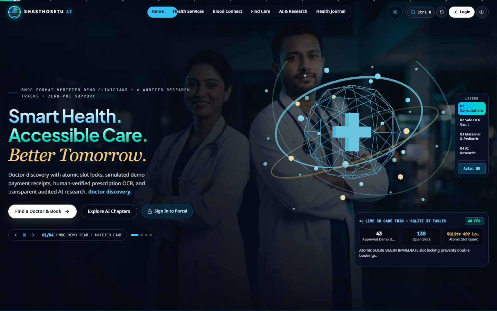
</p>

> **Research & Prototype Disclosure:** ShasthoSetu AI is an open-source clinical informatics research & telemedicine engineering platform. Every diagnostic probability, risk index, triage suggestion, and OCR extraction is strictly **non-diagnostic and human-verified** under licensed clinician oversight.

---

## 🌍 Executive Overview & Problem Statement

Across Bangladesh's **170+ million citizens**, district clinics and rural Upazila Health Complexes face four chronic engineering & clinical barriers:
- Handwritten bilingual prescriptions (`বাংলা` + `English`) cause dangerous dosage misinterpretation when processed by unverified OCR tools.
- Generic cloud AI chatbots **hallucinate medication dosages**, reject code-switched **Banglish** (`"PCOS er symptoms ki?"`), and leak health data off-device.
- Rural emergency coordination (such as urgent cross-matched blood requests) suffers without geo-proximity filtering and contact privacy.
- Non-clinical staff and multi-role systems require strict boundary isolation so support desks never touch private Patient Health Information (PHI).

**ShasthoSetu AI (স্বাস্থ্যসেতু এআই)** delivers an **offline-first, evidence-grounded telemedicine & research operating system**:
1. **Local Edge Clinical RAG (`Recall@1: 95.00% · MRR: 0.9750`):** Hybrid `BM25Okapi` + `bge-m3` dense retrieval over locked DGHS Bangladesh & WHO reference guidelines using local `Qwen 2.5 7B` via Ollama (`:11434`), with deterministic **Code 999** emergency escalation and `0.1 ms` prompt-injection blocking.
2. **Safe-OCR Human Verification Gate (`HTTP 422`):** Bilingual `EasyOCR ['bn','en']` flags low-confidence handwriting tokens and blocks automated medication reminder activation until reviewed by patient or physician.
3. **Six Audited ML/DL Research Prototypes (`research/01..06`):** Full reproducible code, CV metrics, Grad-CAM explainability, and SHA-256 lock manifests verifying zero synthetic/family leakage (`35,641` files archived on Hugging Face).
4. **4-Role Isolated Workspaces & 2-Device Telemedicine:** Enforces Argon2id sessions across **Patient**, **Approved/Pending Doctor**, **Zero-PHI Support Desk (`HTTP 403` guard)**, and **System Admin**, plus a payment-before-call WebRTC consultation room across Bangladesh's 8 divisions.
5. **Interactive 3D Digital Twin & Gyroscopic AI Orb:** Real-time Three.js Volumetric Body Scanner, Care Lattice, Leaflet 8-division healthcare map, dual-mode live voice call / text-to-speech AI, and **Clinical Daylight White Mode**.

---

## 📊 Verified Platform Metrics (In Numbers)

| Category | Verified Measurement | Ground Truth / Verification File |
| :--- | :--- | :--- |
| **Backend API Surface** | **139 route handlers** across **15 FastAPI routers** | [`services/api/src/shasthosetu_api/routers/`](services/api/src/shasthosetu_api/routers) · [`docs/API_REFERENCE.md`](docs/API_REFERENCE.md) |
| **Database Persistence** | **55 SQLite tables** (`54` in schema + replay nonce guard) in **WAL + `BEGIN IMMEDIATE`** | [`schema.sql`](services/api/src/shasthosetu_api/db/schema.sql) · [`docs/DATABASE.md`](docs/DATABASE.md) |
| **Clinical & Geo Directory** | **43 approved demo clinicians**, **8 departments**, **8 Bangladesh divisions**, **12 lab panels** | [`BangladeshCareMap.tsx`](apps/web/src/components/map/BangladeshCareMap.tsx) · [`seed_demo.py`](services/api/src/shasthosetu_api/seeds/seed_demo.py) |
| **Hybrid RRF Clinical RAG** | **Recall@1: `95.00%` · Recall@3: `100.00%` · MRR: `0.9750`** ($N=20$ medical) | [`docs/evidence/AI_RAG_VOICE_OCR_01/rag_eval_table.md`](docs/evidence/AI_RAG_VOICE_OCR_01/rag_eval_table.md) |
| **Automated Backend & Web Tests** | **`65 / 65` passed (`49` pytest + `16` vitest)** + **`0` TypeScript errors** | [`services/api/tests/`](services/api/tests) · [`apps/web/src/test/designSystem.test.tsx`](apps/web/src/test/designSystem.test.tsx) |
| **Audited ML / DL Modules** | **6 clinical research prototypes** (`7/7` read-only SHA-256 lock checks pass) | [`FINAL_AUDIT_SIGNOFF.md`](SHASTHOSETU_FINAL_DATASET_MODEL_AUDIT/final_lock/FINAL_AUDIT_SIGNOFF.md) · [`research/`](research) |
| **MCP & Agent Orchestration** | **3 custom MCP servers** + **4 integrated public/SSE MCPs** + Live **LangGraph** | [`docs/mcp_architecture.md`](docs/mcp_architecture.md) · [`services/agents/`](services/agents) |
| **Business & Commission Treasury** | **4 revenue verticals** (Diagnostic Lab 18%, Doctor 15%, ePharma 12%, Plan 20%), **5 bank escrow accounts**, live admin alerts & 6-month ledger | [`docs/BUSINESS_MODEL.md`](docs/BUSINESS_MODEL.md) · [`/admin/transactions`](apps/web/src/pages/AdminPortalPage.tsx) |
| **Hugging Face Open Dataset** | **35,641 files (`~2.03 GiB`)** across 7 audited dataset folders | [`huggingface.co/datasets/ashik1236/shasthosetu-clinical-datasets`](https://huggingface.co/datasets/ashik1236/shasthosetu-clinical-datasets) |

---

## 📸 Visual Product Tour & Verified UI

Every screenshot below was freshly captured (`1440×900`) from the live running FastAPI (`:8000`) + React/Vite (`:5173`) stack:

<table>
  <tr>
    <td width="50%">
      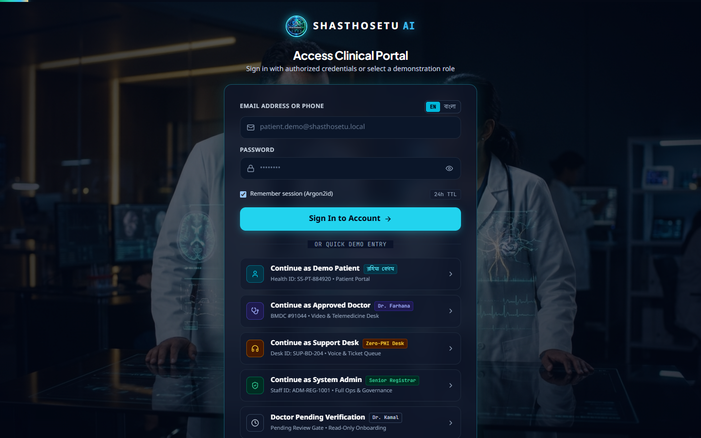
      <br/><sub><b>1. Unified Clinical Portal Login &amp; Role Entry.</b> Argon2id cookie authentication with 1-click access to Patient, Approved Doctor, Support Desk, System Admin, and Pending Doctor onboarding across localhost &amp; tunnels.</sub>
    </td>
    <td width="50%">
      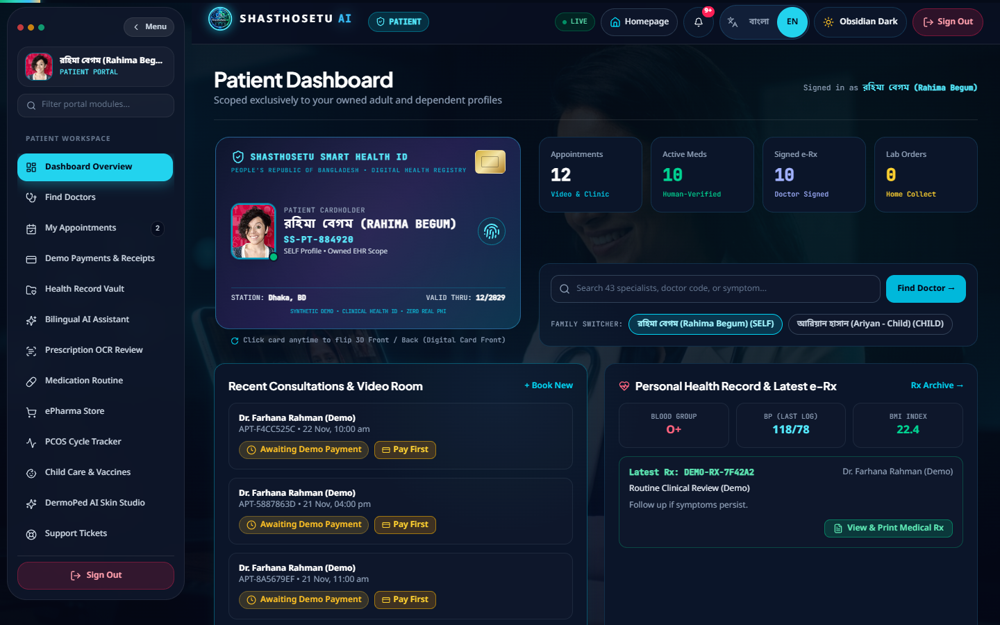
      <br/><sub><b>2. Patient Portal Dashboard &amp; Smart Health ID.</b> Scoped adult/child switcher, live appointments, simulated payment status, signed e-Rx viewer, ePharma shop, and Safe-OCR verification workflows.</sub>
    </td>
  </tr>
  <tr>
    <td width="50%">
      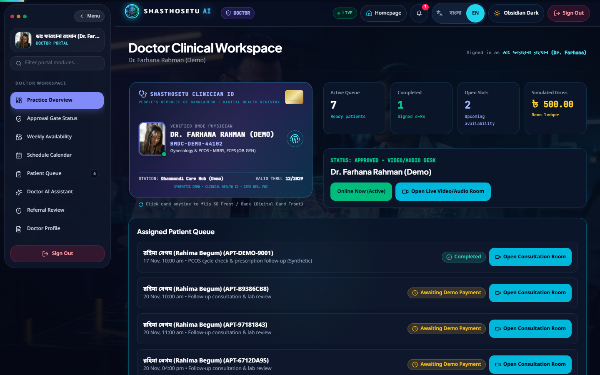
      <br/><sub><b>3. Approved Doctor Clinical Workspace.</b> BMDC-verified clinician ID, live patient queue, 2-device WebRTC consultation rooms, SOAP note recording, and signed e-Prescription issuing.</sub>
    </td>
    <td width="50%">
      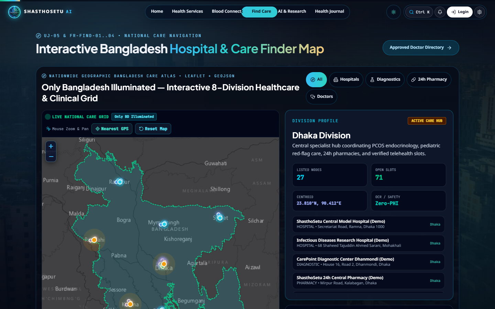
      <br/><sub><b>4. 8-Division Illuminated Bangladesh Clinical Atlas.</b> Interactive Leaflet GeoJSON map filtering hospitals, diagnostic labs, 24h pharmacies, and privacy-masked Blood Connect donors.</sub>
    </td>
  </tr>
  <tr>
    <td width="50%">
      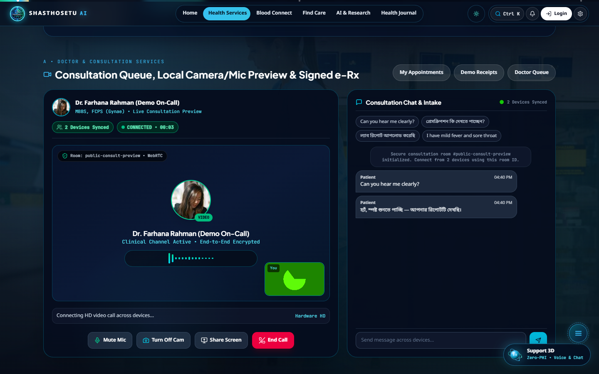
      <br/><sub><b>5. Live 2-Device Telemedicine Call &amp; Health Services.</b> Active WebRTC HD consultation call with live duration timer, audio equalizer, PiP camera feed, mute/screen-share controls, and synced bilingual clinical chat.</sub>
    </td>
    <td width="50%">
      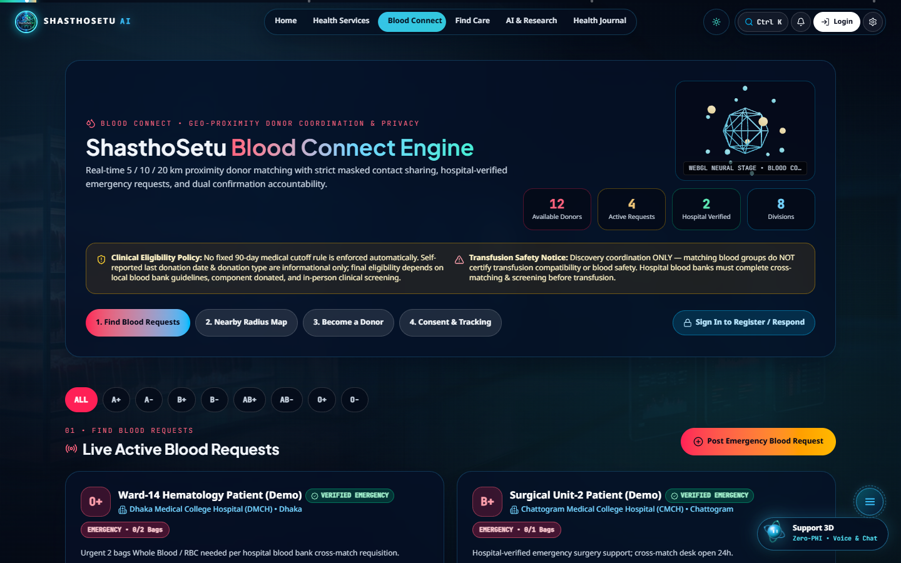
      <br/><sub><b>6. Blood Connect Engine &amp; Donor Privacy.</b> Emergency blood coordination across 8 Bangladesh divisions with hospital-verified badges, blood-group filters, 5/10/20 km matching, and consent-locked donor numbers.</sub>
    </td>
  </tr>
  <tr>
    <td width="50%">
      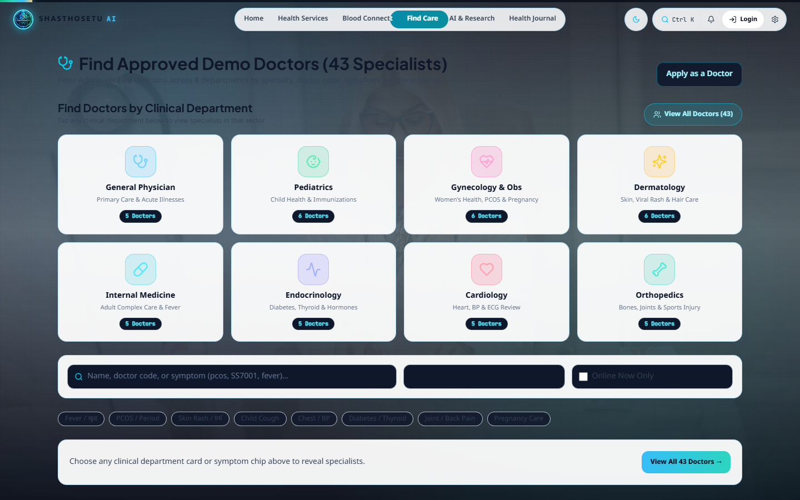
      <br/><sub><b>7. Clinical Daylight White Mode &amp; 8 Specialty Sectors.</b> Accessible high-contrast white surface palette showcasing all 43 approved specialists organized across 8 medical departments.</sub>
    </td>
    <td width="50%">
      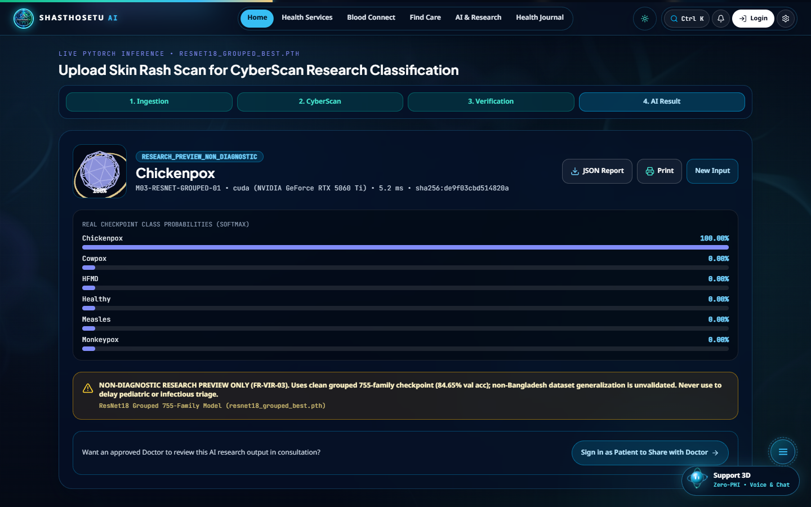
      <br/><sub><b>8. AI Skin Lesion Scan (6-Class ResNet18 Vision).</b> Real PyTorch CUDA inference with 3D confidence telemetry orb, 6-class softmax probability breakdown, and mandatory non-diagnostic clinical review banner.</sub>
    </td>
  </tr>
</table>

---

## 🧠 AI Models & Clinical Research Deep-Dive

### Part A: Generative AI, Hybrid RAG, Voice & Safe-OCR Stack

1. **Hybrid Clinical RAG (`rag_engine.py` + `qwen2.5:7b` + `bge-m3`):**
   Evaluated on $N=26$ golden clinical test queries (`20` medical BN/EN/Banglish + `2` Code 999 emergencies + `2` unanswerable abstentions + `2` prompt injections):

   | Retrieval Mode ($N=20$ Medical) | Recall@1 | Recall@3 | Recall@5 | MRR | Mean Latency | P95 Latency |
   | :--- | :---: | :---: | :---: | :---: | :---: | :---: |
   | **Dense Only (`bge-m3` 1024-d)** | 90.00% | 100.00% | 100.00% | 0.9500 | 215.92 ms | 171.75 ms |
   | **BM25 Only (`BM25Okapi`)** | 80.00% | 90.00% | 95.00% | 0.8542 | **2.62 ms** | 3.02 ms |
   | **Hybrid RRF (Dense + BM25)** | **95.00%** | **100.00%** | **100.00%** | **0.9750** | 141.88 ms | 150.42 ms |

2. **Dual-Mode Bilingual Voice AI (`anuragshas/whisper-small-bn` + `openai/whisper-base`):**
   - Frozen `26`-clip Google FLEURS Bengali benchmark (`22` unique speakers): **Norm WER `39.09%`**, **Bengali Unicode Integrity `98.37%`**.
   - Live UI supports **Mode 1: Hands-Free Voice Call** (direct live microphone + auto-spoken TTS replies) and **Mode 2: Text Chat + On-Demand Listen (`শুনুন`)**, with editable transcript confirmation (`is_confirmed`).
3. **Bilingual Safe-OCR Gate (`EasyOCR ['bn','en']`):**
   - Synthetic Printed Cohort ($N=4$): Precision **`77.78%`**, Recall **`100.00%`**, F1 **`87.50%`**. Unannotated Gazipur clinical smoke (`0052.jpg`): `44` tokens (`59.3%` mean confidence).
   - **Real handwritten CER/WER is explicitly marked `NOT_VALIDATED`** — therefore automated medication reminders lock fail-closed (`HTTP 422`) until human review.

### Part B: All 6 Audited Clinical ML/DL Research Prototypes ([`research/`](research/README.md))

| Module | Architecture | Reproducible Code & Proofs | Audited Benchmark (`FINAL_AUDIT_SIGNOFF.md`) | Honest Research Limitation |
| :--- | :--- | :--- | :--- | :--- |
| **01 PCOS Clinical** | `XGBoost` Tabular Classifier | [`research/01_pcos_clinical/`](research/01_pcos_clinical) | Held-out Bal Acc: **94.44%** (`17/18`) · 50-Fold CV: **88.57%** | $N=88$ Mendeley cohort (`11,919` B CSV); clinical proxy features only. |
| **02 PCOS Ultrasound** | `ResNet-18` Morphology + Grad-CAM | [`research/02_pcos_ultrasound/`](research/02_pcos_ultrasound) | Held-out Test Acc: **86.67%** (`39/45`) | pHash visual clustering ($N=299$); enforces grayscale ultrasound check. |
| **03 Viral Skin Rash** | `ResNet-18` Family-Grouped (`N=755`) | [`research/03_viral_rash_grouped/`](research/03_viral_rash_grouped) | Val Img Acc: **84.65%**, F1: **84.22%** · Test Family: **85.09%** | `0%` source-photo leakage; older `99.10%` leaked model quarantined. |
| **04 Prescription OCR** | `EasyOCR 1.7.2` + `422` Safety Gate | [`research/04_prescription_ocr/`](research/04_prescription_ocr) | Smoke `0052.jpg`: **44 tokens** · Printed F1: **87.50%** | Handwritten CER/WER `NOT_VALIDATED`; reminders locked (`SIMULATED_REVIEW_ONLY`). |
| **05 Bangla Voice AI** | `Whisper-Small-BN` + `Whisper-Base` | [`research/05_bangla_voice_ai/`](research/05_bangla_voice_ai) | 26 FLEURS: **39.09% Norm WER**, **98.37% BN Unicode** | General-domain speech; mandatory transcript confirmation gate. |
| **06 DermoPed Skin** | `ResNet-18` (`EXP_B` / `EXP_D`) | [`research/06_dermoped_pediatric_skin/`](research/06_dermoped_pediatric_skin) | Test Img Acc (`EXP_B`): **92.73%** | `22` local patients (`19` Chickenpox, **only `3` Pediculosis**); PoC + skin check. |

<details>
<summary>
<h3>
  
  &nbsp;👉 <b>CLICK TO EXPAND: Mandatory Medical Safety, Regulatory &amp; Privacy Disclosures</b>
</h3>
</summary>

1. **Non-Diagnostic Research Platform:** ShasthoSetu AI is strictly NOT a medical device and never issues autonomous prescriptions or diagnoses. Clinician review is mandatory before acting on any summary.
2. **Heuristic Privacy vs. Certification:** Zero-PHI regex/masking (`+880 17•• •••12`), Argon2id cookies, and local SQLite WAL isolation are software engineering safeguards — they do **not** claim formal HIPAA, GDPR, or BMDC certification.
3. **Synthetic Payments & Clinicians:** All seeded users, doctors (`BMDC-DEMO-*`), receipts, and helplines (`+880 9612-SHASTHO`) exist exclusively for safe demonstration.
4. **Full Details:** Read [`docs/KNOWN_LIMITATIONS.md`](docs/KNOWN_LIMITATIONS.md) and [`SHASTHOSETU_FINAL_DATASET_MODEL_AUDIT/final_lock/FINAL_AUDIT_SIGNOFF.md`](SHASTHOSETU_FINAL_DATASET_MODEL_AUDIT/final_lock/FINAL_AUDIT_SIGNOFF.md).

</details>

---

## 🧪 Frontend, Backend Tests & Audit Verification

All automated suites across the Python backend, React/TypeScript frontend, E2E Playwright harness, MCP suite, and SHA-256 dataset lock are documented below so evaluators can reproduce every pass independently:

### 1. Backend Automated Test Suite (`services/api/tests/` — **49 / 49 Passed**)

```powershell
cd services/api
$env:PYTHONPATH = "src;../.."
python -m pytest tests -q
```

| Test File | Tests | What It Verifies |
| :--- | :---: | :--- |
| [`services/api/tests/test_ai_rag_voice_ocr.py`](services/api/tests/test_ai_rag_voice_ocr.py) | **25 Passed** | Hybrid RAG citation grounding, online & offline LLM fallback, Code 999 crisis escalation, BN/EN/Banglish prompt-injection refusals, Whisper audio draft gate (`is_confirmed`) & offline resilience, Safe-OCR `HTTP 422` reminder lock, clinician sign-off, RAG source governance |
| [`services/api/tests/test_fullstack_api.py`](services/api/tests/test_fullstack_api.py) | **10 Passed** | Auth Argon2id login & role-escalation lockout, SQLite `BEGIN IMMEDIATE` slot lock (`HTTP 409`), simulated payment receipts, Support **`HTTP 403` Zero-PHI wall**, Pending doctor gate, cross-doctor IDOR denial, Blood Connect masking |
| [`services/api/tests/test_ocr_regression.py`](services/api/tests/test_ocr_regression.py) | **10 Passed** | Safe-OCR medicine candidate normalization, brand name fuzzy recovery, timing/duration normalization, low-resolution unsharp mask enhancement, and HTTP 422 guardrails |
| [`services/api/tests/test_rag_metric_lock_02.py`](services/api/tests/test_rag_metric_lock_02.py) | **4 Passed** | Recomputes Dense (`0.9500` MRR), `BM25` (`0.8542` MRR, `EN-06` root-cause trace), and Hybrid RRF (`0.9750` MRR) metrics from raw traces and asserts exact parity with published tables |

*(Additional standalone security & evaluation harnesses live in [`services/api/evals/`](services/api/evals): `test_demo_isolation_security.py`, `test_ocr_authorization_gate.py`, `test_webhook_security.py`, `verify_six_ai_tools.py`, `benchmark_all_rag_modes.py`.)*

### 2. Frontend TypeScript, Vitest Unit Suite & Production Build (**16 / 16 Passed · 0 TS Errors**)

```powershell
cd apps/web
npm run typecheck    # Strict tsc --noEmit -> 0 errors
npm run test         # Vitest 16/16 unit & accessibility tests passed
npm run build        # Production Vite 6 bundle -> apps/web/dist/
```

- **[`apps/web/src/test/designSystem.test.tsx`](apps/web/src/test/designSystem.test.tsx) (`16 / 16 Passed`):** Verifies 100% `bn.json`/`en.json` translation key parity (`#1`), BN/EN toggle persistence (`#2`), Obsidian Dark / Clinical White theme toggle (`#3`), WCAG reduce-motion switch (`#4`), modal focus trap (`#5`), keyboard pill tabs (`#6`), RBAC role sidebar guards (`#7`), searchable/sortable DataTable (`#8`), TrustBadges & feedback states (`#9`), Poisha integer BDT + `Asia/Dhaka` formatting (`#10`), PublicHome `/` + Hero lattice (`#11`), dedicated feature pages & Care Map (`#12`), medical receipt & prescription document rendering (`#13–#14`), doctor profile modal (`#15`), and demo payment gateway method labeling (`#16`).
- **Playwright Browser E2E Suites ([`apps/web/e2e/`](apps/web/e2e)):** `ui01.spec.ts`, `fullstack01.spec.ts`, `ai_rag_voice_ocr_01.spec.ts` (`npm run test:e2e`).

### 3. Research Hash Lock & MCP Server Verification

| Verification Tool | Command | Outcome | Scope |
| :--- | :--- | :---: | :--- |
| **Final Audit Lock** | `python SHASTHOSETU_FINAL_DATASET_MODEL_AUDIT/final_lock/verify_final_lock.py` | **7 / 7 Suites Pass** | Verifies CSV counts (`N=88` PCOS, `755` MCVSLD families, `1,000` Rx splits, `22` DermoPed pts) & SHA-256 checkpoint hashes |
| **MCP Suite Verifier** | `python services/mcp/verify_mcp_suite.py` | **JSON-RPC Pass** | Verifies live `stdio` tool/resource discovery across `guideline`, `directory`, `care_record`, `filesystem`, `memory`, & `sequential-thinking` |

---

## 🏛️ Technical Architecture & Engineering Pipelines

### 1. High-Level 6-Layer System Architecture Topology

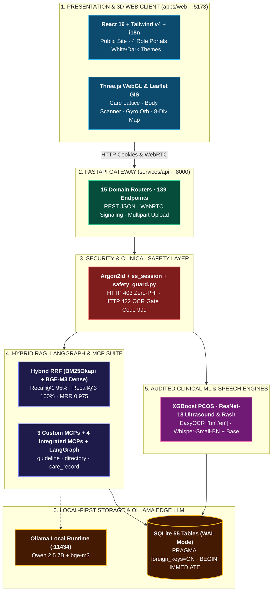

### 2. Bilingual Hybrid RAG & Clinical Safety Pipeline

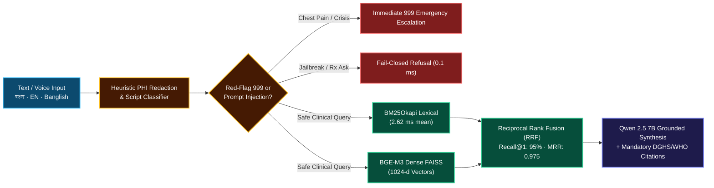

### 3. Safe-OCR `HTTP 422` Human-in-the-Loop Verification Gate

```mermaid
sequenceDiagram
    autonumber
    actor P as Patient / User
    participant API as FastAPI Safe-OCR Engine
    participant DB as SQLite Medication Plans
    participant MD as Approved Clinician

    P->>API: POST /v1/ai/ocr/extract (PDF / JPG / PNG)
    API->>API: EasyOCR ['bn','en'] + Line Clustering + Confidence Audit
    API-->>P: Return RAW_OCR Draft + Flagged Uncertain Tokens

    rect rgb(75, 18, 28)
        Note over P,API: Non-Bypassable Safety Lockout
        P->>API: Attempt Automated Reminder Activation (Unconfirmed)
        API-->>P: HTTP 422 Unprocessable Entity — Human Verification Required
    end

    rect rgb(12, 58, 45)
        Note over P,MD: Verified Authorization Flow
        P->>API: Confirm Reviewed Draft (or Route to MD)
        MD->>API: Clinician Verification Sign-off
        API->>DB: Save Authorized Plan + Audit Trail
        API-->>P: 201 Created — Medication Reminders Active
    end
```

### 4. Four-Role RBAC & Zero-PHI Isolation Architecture

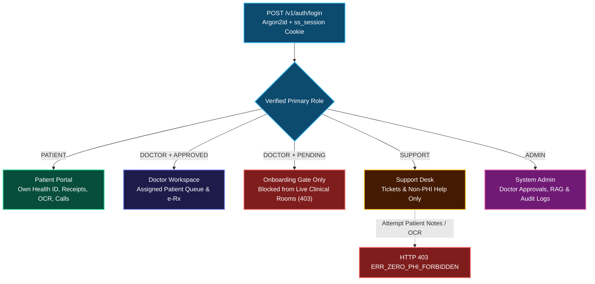

### 5. Payment-Before-Call 2-Device WebRTC Telemedicine Pipeline

```mermaid
flowchart LR
    classDef slot fill:#0c4a6e,stroke:#38bdf8,stroke-width:2px,color:#fff;
    classDef pay fill:#451a03,stroke:#fbbf24,stroke-width:2px,color:#fff;
    classDef intake fill:#064e3b,stroke:#34d399,stroke-width:2px,color:#fff;
    classDef call fill:#701a75,stroke:#f472b6,stroke-width:2px,color:#fff;

    S1["1. Select Clinician<br/>SQLite BEGIN IMMEDIATE Slot Lock"]:::slot --> S2["2. Simulated Payment Gate<br/>(No Call Before Payment Rule)"]:::pay
    S2 -->|"Payment Settled"| S3["3. Pre-Call Intake Form<br/>Symptoms · Report · Voice Note"]:::intake
    S3 --> S4["4. Live 2-Device WebRTC Room<br/>POST /v1/consultations/rooms/apt-demo-9001"]:::call
    S4 --> S5["5. Clinician SOAP Notes &amp; Signed e-Rx"]:::slot
```

---

## ⚡ 10-Minute Local Quickstart

### Option A: 1-Click Windows Launch
```powershell
git clone https://github.com/ashik123-a1/ShasthoSetu-AI.git
cd ShasthoSetu-AI

python -m venv .venv
.\.venv\Scripts\Activate.ps1
pip install -r requirements.txt
cd apps\web && npm.cmd install && cd ..\..

# Starts FastAPI (:8000) & Vite (:5173) — auto-seeds demo SQLite DB if missing
.\start.bat
# Optional flags: .\start_shasthosetu.ps1 -ResetDemoDb -WithTunnel
```

<details>
<summary>
<h3>
  
  &nbsp;👉 <b>CLICK TO EXPAND: Cross-Platform Setup, Ollama AI, Full Dataset Pull &amp; Troubleshooting</b>
</h3>
</summary>

### Manual Cross-Platform Setup (Windows / Linux / macOS)
```bash
git clone https://github.com/ashik123-a1/ShasthoSetu-AI.git
cd ShasthoSetu-AI
cp .env.example .env

python -m venv .venv
source .venv/bin/activate        # Windows: .\.venv\Scripts\Activate.ps1
pip install -r requirements.txt

# Seed 55 SQLite WAL tables (43 clinicians, 8 divisions, 5 demo accounts)
PYTHONPATH="services/api/src:." python -m shasthosetu_api.seeds.seed_demo

# Terminal 1: FastAPI backend (:8000, bound cleanly to 0.0.0.0)
PYTHONPATH="services/api/src:." python -m uvicorn shasthosetu_api.main:app --host 0.0.0.0 --port 8000

# Terminal 2: React + Vite frontend (:5173)
cd apps/web && npm install && npm run dev
```

### Enable Local Edge LLM & Dense Embeddings (Optional Ollama)
```bash
ollama pull qwen2.5:7b
ollama pull bge-m3
ollama serve
```

### Instant QA Pack vs. Full Hugging Face Datasets
- **Ready Out of the Box ([`testingmainapps/`](testingmainapps)):** A curated **1.01 MB** sample test pack (`01_prescription_ocr/` through `05_rag_bilingual_assistant/`) is tracked directly in Git for 5-minute testing.
- **Full Research Dataset Archive (`~2.03 GiB` / `35,641` files on Hugging Face):**
  ```bash
  pip install huggingface-hub
  hf download ashik1236/shasthosetu-clinical-datasets --repo-type dataset --local-dir ./hf_datasets
  ```

### Troubleshooting
- **PowerShell blocks `npm`:** Run `npm.cmd run dev` / `npm.cmd test`, or run `.\start.bat`.
- **Reset demo SQLite DB cleanly:** `.\start_shasthosetu.ps1 -ResetDemoDb`.

</details>

### 5-Account Demo Personas (1-Click on `/login`, Works on Localhost & Tunnels)

| Role | Email Identifier | Password | Portal Route | Access Scope |
| :--- | :--- | :--- | :--- | :--- |
| **Patient** | `patient.demo@shasthosetu.local` | `PatientDemo#2026` | `/patient/dashboard` | Appointments, Safe-OCR, ePharma cart, PCOS/Child tools |
| **Approved Doctor** | `dr.farhana@shasthosetu.local` | `DoctorDemo#2026` | `/doctor/dashboard` | Consultations, SOAP notes, e-Rx signing, AI draft review |
| **Pending Doctor** | `dr.pending@shasthosetu.local` | `DoctorDemo#2026` | `/doctor/onboarding-status` | Guarded onboarding queue (`403` blocked from patient rooms) |
| **Support Desk** | `support.demo@shasthosetu.local` | `SupportDemo#2026` | `/support/dashboard` | Ticket desk (`HTTP 403` Zero-PHI clinical note isolation) |
| **System Admin** | `admin.demo@shasthosetu.local` | `AdminDemo#2026` | `/admin/dashboard` | Clinician approvals, RAG indexing & immutable audit logs |

---

## 📂 Where Everything Lives (Project Map)

Annotated directory map so evaluators can locate every application file, AI model, test, and dataset in seconds:

```text
ShasthoSetu-AI/
├── README.md                                      # Executive showcase, UI tour, benchmarks & quickstart (you are here)
├── LICENSE                                        # MIT Open Source License
├── requirements.txt                               # Unified Python 3.10–3.12 runtime, ML, OCR, ASR & pytest dependencies
├── start.bat / start_shasthosetu.ps1              # 1-Click Windows launchers (auto-seeds SQLite + FastAPI + Vite)
├── .env.example / .mcp.json / .gitignore          # Safe env template, portable MCP config & clean ignore policy
│
├── apps/web/                                      # React 19 + TypeScript + Vite 6 + Three.js + Leaflet Frontend
│   ├── e2e/                                       # 3 Playwright full-stack browser E2E suites
│   ├── public/images/team/                        # Official 5-member team portraits (Nakib..Rifah)
│   ├── src/components/                            # Three.js Care Lattice, Volumetric Body Scanner, MedicalAiChatbotOrb
│   ├── src/pages/                                 # Public Landing, Blood Connect, Care Map, Services, Research & 4 Portals
│   ├── src/data/teamData.ts                       # Single source of truth for the 5-member engineering roster
│   └── src/test/designSystem.test.tsx             # 15 automated Vitest unit & accessibility tests (0 TS errors)
│
├── services/
│   ├── api/                                       # FastAPI Backend (15 Domain Routers · 139 Endpoints · 55 SQLite Tables)
│   │   ├── src/shasthosetu_api/db/schema.sql      # 54 normalized SQLite tables (+ webhook_replay_nonces = 55) in WAL mode
│   │   ├── src/shasthosetu_api/routers/           # auth, public, patient, doctor, consultations, blood_connect, ai_*, admin*, support
│   │   ├── src/shasthosetu_api/services/          # rag_engine, safety_guard, ocr_service, ml_inference, voice_asr/tts
│   │   ├── src/shasthosetu_api/seeds/seed_demo.py # Deterministic seeder (43 clinicians, 8 divisions, 5 demo personas)
│   │   ├── evals/                                 # Quantitative RAG, OCR, Voice, security & isolation evaluators
│   │   ├── tests/                                 # 38 automated pytest tests (test_ai_rag_voice_ocr, test_fullstack_api, metric_lock)
│   │   └── passenger_wsgi.py                      # cPanel shared-hosting WSGI bridge
│   ├── agents/                                    # Live LangGraph clinical triage + CrewAI / AutoGen / OpenAI SDK adapters
│   └── mcp/                                       # 3 custom MCP servers (guideline, directory, care_record) + verifier
│
├── research/                                      # Reproducible Code, Configs & Audits for All 6 Clinical AI Modules
│   ├── README.md                                  # Faculty overview of all 6 modules, metrics, limits & HF data link
│   ├── 01_pcos_clinical/                          # XGBoost tabular training, configs & cross-validation (N=88)
│   ├── 02_pcos_ultrasound/                        # ResNet-18 ultrasound code, Grad-CAM visuals & training curves (N=299)
│   ├── 03_viral_rash_grouped/                     # 755 source-photo family grouped code, leakage audits & Grad-CAM
│   ├── 04_prescription_ocr/                       # EasyOCR bilingual pipeline, Gazipur audit manifests & model card
│   ├── 05_bangla_voice_ai/                        # Whisper-BN vs Whisper-Base FLEURS scripts & CER/WER charts
│   └── 06_dermoped_pediatric_skin/                # DermoPed EXP_B / EXP_D training & patient-level split audits
│
├── SHASTHOSETU_FINAL_DATASET_MODEL_AUDIT/         # Frozen SHA-256 verification lock & verify_final_lock.py (7/7 suites pass)
├── testingmainapps/                               # Curated 1 MB 5-System QA pack + negative controls for instant UI/API tests
├── workflows/                                     # n8n, Prefect, and Dagster clinical automation definitions
├── scripts/                                       # HF dataset export, RAG index builder, local benchmarks & cPanel smoke test
│
└── docs/                                          # Complete A–Z Engineering Documentation Library (14 Guides + Evidence)
    ├── readme/                                    # Custom banner.svg + 9 verified 1440×900 UI screenshots
    └── evidence/ & HF_DATASET_PROVENANCE_AUDIT_01/# Raw JSON/MD evaluation traces, DOIs & ethical provenance audits
```

---

## 📚 Complete A–Z Documentation Index

| Book / Guide | What You Will Find Inside |
| :--- | :--- |
| 📘 [`docs/INSTRUCTION_BOOK.md`](docs/INSTRUCTION_BOOK.md) | Complete A–Z installation, first launch, 5-role evaluation guide, Ollama & troubleshooting |
| 🏗️ [`docs/ARCHITECTURE.md`](docs/ARCHITECTURE.md) | 6-layer topology, SQLite `BEGIN IMMEDIATE` locks, colored Mermaid flows & 3D Orb architecture |
| 💰 [`docs/BUSINESS_MODEL.md`](docs/BUSINESS_MODEL.md) | Business architecture, 4 revenue verticals, 18% lab & 15% doctor commission splits, live admin transaction alerts & 5-bank settlement |
| 🧠 [`docs/ENGINEERING.md`](docs/ENGINEERING.md) | Comprehensive engineering handbook (`v2.5.0`), subsystem highlights & team summary |
| 🔌 [`docs/API_REFERENCE.md`](docs/API_REFERENCE.md) | Complete REST, WebRTC & MCP catalog across all **15 routers (139 endpoints)** |
| 🗄️ [`docs/DATABASE.md`](docs/DATABASE.md) | Full inventory of all **55 SQLite WAL tables**, pragmas, seeding & migrations |
| 🛡️ [`docs/SECURITY.md`](docs/SECURITY.md) | Argon2id cookies, `HTTP 403` Zero-PHI support isolation & **`HTTP 422`** Safe-OCR gate |
| 🧪 [`docs/TESTING.md`](docs/TESTING.md) | Breakdown of all `38` Pytest, `15` Vitest, `3` Playwright E2E, & `7` Final-Lock checks |
| 👥 [`docs/USER_ROLES_AND_PERMISSIONS.md`](docs/USER_ROLES_AND_PERMISSIONS.md) | 6-persona RBAC matrix & portal-by-portal evaluation steps |
| 🤖 [`docs/MODEL_CARDS.md`](docs/MODEL_CARDS.md) | Model cards covering `qwen2.5:7b`, `bge-m3`, `whisper`, & all 6 ML/DL research prototypes |
| 📊 [`docs/DATASETS.md`](docs/DATASETS.md) | Hugging Face `35,641`-file repository guide, academic DOIs, SHA-256 hashes & takedown policy |
| ⚠️ [`docs/KNOWN_LIMITATIONS.md`](docs/KNOWN_LIMITATIONS.md) | Honest clinical & engineering boundaries (including `NOT_VALIDATED` handwritten OCR) |
| 🚀 [`docs/DEPLOYMENT.md`](docs/DEPLOYMENT.md) | Local dev, Ollama GPU setup, Cloudflare/ngrok tunneling & cPanel Passenger WSGI deployment |
| 🔗 [`docs/mcp_architecture.md`](docs/mcp_architecture.md) | 3 custom Python MCP servers (`stdio`, `sse`, `streamable-http`) + 4 integrated MCPs |
| 📂 [`docs/PROJECT_STRUCTURE.md`](docs/PROJECT_STRUCTURE.md) | 3-tier GitHub vs. Hugging Face vs. `.gitignore` separation guide |
| 🔬 [`research/README.md`](research/README.md) | Reproducible research index & benchmark summary across Modules `01–06` |
| 📋 [`testingmainapps/DOCUMENTATION.md`](testingmainapps/DOCUMENTATION.md) | Step-by-step hands-on QA manual using the built-in 1 MB sample test files |

---

## 👥 Official Engineering Team

Synced directly with [`apps/web/src/data/teamData.ts`](apps/web/src/data/teamData.ts):

<table>
  <tr>
    <td align="center" width="20%">
      <br/>
      <b>Nakib Md Ashik</b><br/>
      <sub><b>Team Leader &amp; System Architect</b><br/>Bilingual RAG · Whisper · Full-Stack<br/><code>+880 1771449164</code><br/><code>ashiknakib25@gmail.com</code></sub>
    </td>
    <td align="center" width="20%">
      <br/>
      <b>Mynuddin Ahmed</b><br/>
      <sub><b>Frontend &amp; 3D Spatial UX</b><br/>Three.js 3D Twins · Leaflet Atlas<br/><code>+880 1643897205</code><br/><code>mayanahmedopu@gmail.com</code></sub>
    </td>
    <td align="center" width="20%">
      <br/>
      <b>Hasin Ishruq</b><br/>
      <sub><b>Clinical AI &amp; ML Research</b><br/>EasyOCR · PyTorch · Guardrails<br/><code>+880 1405080369</code><br/><code>hasin.ishruq@gmail.com</code></sub>
    </td>
    <td align="center" width="20%">
      <br/>
      <b>Al Kabir</b><br/>
      <sub><b>Backend, Security &amp; Telemetry</b><br/>FastAPI · 55-Table WAL · Zero-PHI<br/><code>+880 01798323391</code><br/><code>alkabir.cse@gmail.com</code></sub>
    </td>
    <td align="center" width="20%">
      <br/>
      <b>Rifah Sunjidah Remu</b><br/>
      <sub><b>Clinical QA &amp; Health Informatics</b><br/>Dataset Validation · UAT · Audits<br/><code>+880 1798727607</code><br/><code>rifahsunjidahremu@gmail.com</code></sub>
    </td>
  </tr>
</table>

<p align="center"><sub>Engineered in Dhaka, Bangladesh 🇧🇩 for bilingual, accessible clinical decision-support &amp; telemedicine research.</sub></p>

---

## 📜 Attribution & License

- **Source Code & Documentation:** Released openly under the **[MIT License](LICENSE)**.
- **Academic & Clinical Reference Standards:** DGHS Bangladesh National Dengue & Immunization Guidelines, WHO Acute Triage Protocols, Mendeley Data (`10.17632/tw34c7hv7z.1`, `10.17632/dfztdtfsxz.1`, `10.17632/tg2hm7n2bs.2`), Frontiers in Physiology (`10.3389/fphys.2025.1520898`), Zenodo Record (`10.5281/zenodo.20829589`), Google FLEURS `bn_in` (`arXiv:2205.12446`). See [`docs/DATASETS.md`](docs/DATASETS.md) and [`02_LICENSE_AND_CONSENT_AUDIT.md`](docs/HF_DATASET_PROVENANCE_AUDIT_01/02_LICENSE_AND_CONSENT_AUDIT.md) for complete citations & notice-takedown terms.
