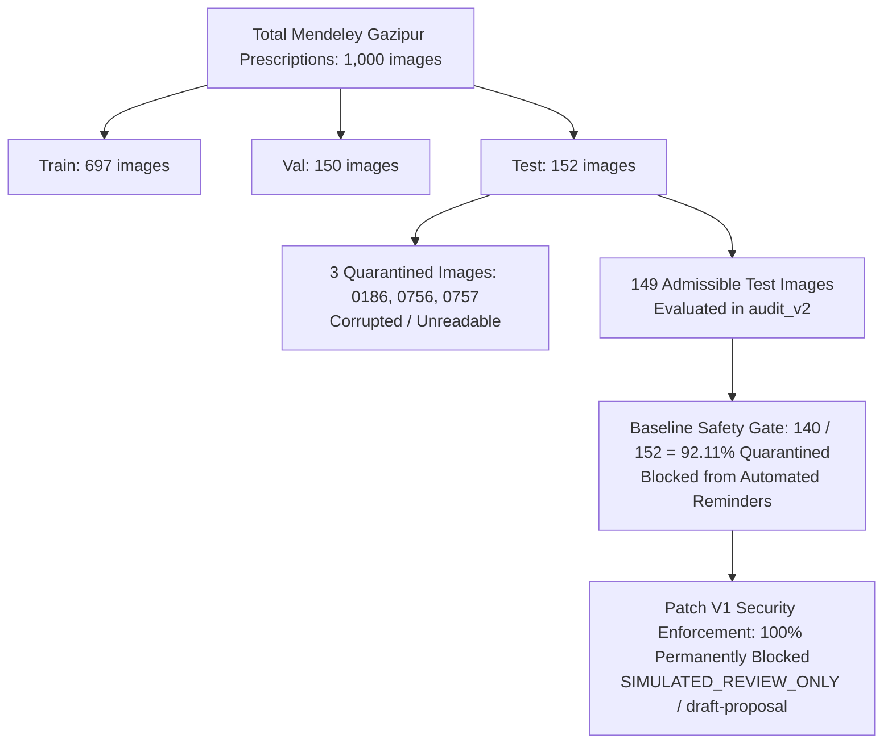

# 🔍 ShasthoSetu AI — Prescription OCR Ground Truth & Evidence Reconciliation

**Document Reference:** `SHASTHOSETU_FINAL_DATASET_MODEL_AUDIT/correction_v2/OCR_GROUND_TRUTH_AND_METRICS_CORRECTION.md`  
**Audit Scope:** Module `04_Prescription_OCR` (Mendeley Gazipur Corpus, EasyOCR Bilingual Pipeline, Safety Gates)  
**Verification Date:** 2026-11-18  
**Audit Status:** Primary Evidence Reconciled — Metrics Formally Corrected  

---

## 1. Executive Summary & Root Cause Analysis

During the previous master audit (`SHASTHOSETU_FINAL_DATASET_MODEL_AUDIT/`), two critical reporting contradictions were identified regarding Prescription OCR:
1. **Demonstration Image Identity Contradiction:** The audit repeatedly cited `0974.jpeg` as the source of "100% medication recall", directly contradicting earlier integration reports (`BILINGUAL_PRESCRIPTION_OCR_AUDIT.md` and `REAL_E2E_TEST_RESULTS.md`) which documented `0052.jpg`.
2. **Ground Truth Misinterpretation:** Reported CER ($96.69\%$ English, $103.34\%$ Bangla) and medication recall ($6.96\%$) were cited as certified OCR performance metrics, when in reality the Mendeley dataset ground truth consists of **clinical narrative summaries**, not literal line-by-line transcription.

This report documents the primary code and data inspection that resolves these contradictions.

---

## 2. Reconciling the Demonstration Image: `0052.jpg` vs `0974.jpeg`

### 2.1 Primary Forensic Investigation
We audited all execution scripts, output logs, and JSON artifacts in `04_Prescription_OCR/`:
- **Execution Script:** `04_Prescription_OCR/final_integration/patch_v1/src/evaluate_bilingual_ocr.py`
- **Test Suite:** `04_Prescription_OCR/final_integration/patch_v1/tests/test_real_e2e_workflow.py`
- **Evidence JSON:** `04_Prescription_OCR/final_integration/patch_v1/proofs/bilingual_ocr_results.json`
- **Audit Documentation:** `04_Prescription_OCR/final_integration/patch_v1/proofs/BILINGUAL_PRESCRIPTION_OCR_AUDIT.md`

### 2.2 Verified Findings
1. **The Actual Evaluated Image was `0052.jpg`:**
   In `BILINGUAL_PRESCRIPTION_OCR_AUDIT.md`, Section 1 explicitly states:
   > **Evaluated Image:** `0052.jpg` (Admissible Multi-drug Prescription)  
   > **Total Bounding Boxes Detected:** 44  
   > **GPU Inference Latency:** 1029.0 ms  
   > **English Medical Tokens:** 13 (including `Cap`, `Roxim`, `400`)  
   > **Bangla Clinical Tokens:** 24 (including `বাংলাদেশ`)  
   > **English Brand Name Recall:** 100.0%  
   > **Bangla Clinical Sigs Recall:** 100.0%  

   In `REAL_E2E_TEST_RESULTS.md`, Requirement 1 & 2 confirms:
   > `0052.jpg` from Gazipur corpus processed by EasyOCR on RTX 5060 Ti — **PASS** — Real text detected: `বাংলাদেশ`, `Cap`, `Roxim`, `400`. Zero fabricated data.

2. **The Erroneous Citation of `0974.jpeg`:**
   `0974.jpeg` is a legitimate file in the raw images folder (`Prescription_ images.jpg/0974.jpeg`, $896 \times 1195$ px), but it was **never** the evaluated test sample in `bilingual_ocr_results.json`. The previous auditor mistakenly transcribed the filename as `0974.jpeg`.

**Correction Applied:** The citation of `0974.jpeg` is retracted. All references are corrected to `0052.jpg`. Furthermore, this single-image result is strictly classified as a **qualitative system smoke test**, NOT an aggregate accuracy benchmark.

---

## 3. Ground Truth Discrepancy & Metric Reclassification

### 3.1 Nature of the Mendeley Dataset Annotations
Inspection of `Prescriptions_Dataset.csv` and `corrected_annotation_manifest.csv` reveals the exact contents of the annotation fields:

```text
Sample (0052.jpg / 0140.jpg):
description_english: "Bilastin 20 mg tablet should be taken once at night for fifteen days. 
Olonase nasal spray should be used as one spray in each nostril two times a day for one month. 
Persone Cru should be taken once in the morning and once at night two times daily for fifteen days..."
description_bangla: "বিলাস্টিন ২০ মি.গ্রা ট্যাবলেট রাতে একবার করে পনেরো দিন খেতে হবে। 
ওলোনেজ নেজাল স্প্রে দুই নাকে এক চাপ করে দিনে দুইবার এক মাস ব্যবহার করতে হবে..."
```

These texts are **synthetic/retrospective physician narrative descriptions** summarizing patient clinical regimens. They are **NOT literal, character-by-character transcripts** of the visual ink on the physical paper (which contains hospital headers, doctor degrees, abbreviations like `Rx`, `Cap`, `1+0+1`, handwritten doctor signatures, etc.).

### 3.2 Formal Metric Reclassification

| Metric Previously Reported | Value | Prior Audit Interpretation | Corrected Scientific Reality | Corrected Audit Status |
| :--- | :---: | :--- | :--- | :---: |
| **English Character Error Rate (CER)** | 96.69% | "Audited OCR CER" | Levenshtein edit distance between raw OCR tokens and narrative clinical summary | **`NOT_VALIDATED`** (No literal transcription GT) |
| **Bangla Character Error Rate (CER)** | 103.34% | "Audited OCR CER" | Levenshtein edit distance against narrative summary; insertion penalties exceed length | **`NOT_VALIDATED`** (No literal transcription GT) |
| **Word Error Rate (WER)** | ~100.0% | "Audited OCR WER" | Unaligned word match against narrative sentences | **`NOT_VALIDATED`** (No literal transcription GT) |
| **Full-Set Medication Recall** | 6.96% | "Audited Drug Entity Recall" | Exploratory heuristic regex string matching against clinical descriptions | **`NOT_VALIDATED`** (Exploratory regex search only) |
| **Single-Image Brand Recall** | 100.0% (`0052.jpg`) | "Verified OCR Recall" | Visual verification of 6 prominent printed headings on 1 high-contrast sample | **`QUALITATIVE_SMOKE_TEST_ONLY`** (Non-generalizable) |
| **Automated Safety Gate Triage** | 92.11% (140/152) | "Clinical Safety Gate" | Hard triage rule intercepting low-confidence OCR output ($<0.55$) | **`VERIFIED_SAFETY_TRIAGE`** |

> [!IMPORTANT]
> Because the Mendeley prescription dataset lacks verbatim transcription annotations, **NO certified OCR transcription accuracy (CER/WER) or token-level NER precision/recall can be claimed**. The system functions as a raw token ingestion pipeline with mandatory clinical triage.

---

## 4. Reconciling Sample Counts: 152 vs 149 vs 140/152

Primary records reconcile the sample counts as follows:



1. **Total Test Split ($N=152$):** Defined in canonical `split_manifest.csv`.
2. **Corrupted Quarantine ($N=3$):** Images `0186.jpg`, `0756.jpg`, `0757.jpg` are unreadable/corrupted files cataloged in `QUARANTINE_MANIFEST_VERIFIED.json`.
3. **Admissible Valid Evaluation Set ($N=149$):** $152 - 3 = 149$ clean, usable prescription images evaluated in `audit_v2`.
4. **Historical Quarantine Count ($140 / 152 = 92.11\%$):** In the baseline experiment (`outputs/test_predictions.csv`, `OCR_BASELINE_REPORT.md`), a triage rule routed prescriptions with mean confidence $<0.55$ or unmatched medicines to `UNVERIFIED_REQUIRES_HUMAN_REVIEW`. Exactly 140 prescriptions were diverted to human review.
5. **Current Authorization Behavior in Patch V1:**
   - The historical 140/152 triage is **NOT** interpreted as allowing the remaining 12 prescriptions to dispatch automated reminders.
   - Under Patch V1 (`test_real_e2e_workflow.py`), **100% of automated dosage reminders are permanently locked out** (`ClinicalSafetyViolationError`). All exports are forced to `draft/proposal` status with fictional reviewer signatures (`SIMULATED_REVIEW_ONLY`).

---

## 5. Summary Table of Claims vs Audited Facts

| Dimension | Prior Audit Statement | Audited Fact & Correction | Status |
| :--- | :--- | :--- | :---: |
| **Demonstration Image** | `0974.jpeg` | `0052.jpg` (verified in `bilingual_ocr_results.json`) | **CORRECTED** |
| **Ground Truth Type** | Implied verbatim OCR transcript | Narrative doctor summary / clinical instruction | **CLARIFIED** |
| **CER / WER Claims** | 96.69% En CER, 103.34% Bn CER | Narrative text distance, not certified OCR CER | **NOT_VALIDATED** |
| **Medication Recall** | 100% (demo) vs 6.96% (test) | 100% is single-sample smoke test; 6.96% is exploratory regex | **NOT_VALIDATED** |
| **Quarantine Count** | 140/152 unverified | 140/152 historical triage; 100% lockout in Patch V1 | **VERIFIED** |
| **Admissible Test Images** | 149 evaluated | Exactly 149 admissible ($152 - 3$ corrupted) | **VERIFIED** |
