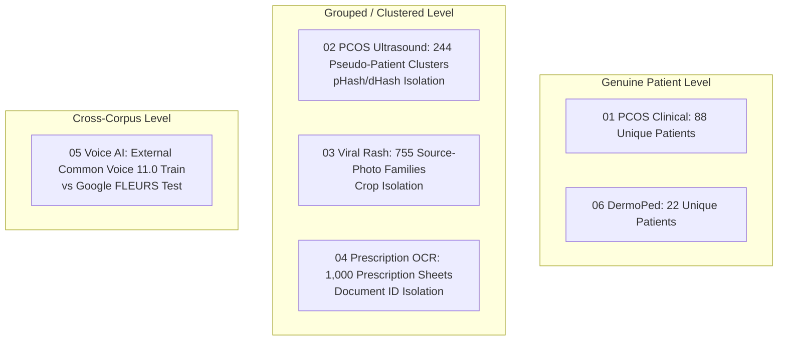

# 🔬 ShasthoSetu AI — Reproducibility & Scientific Evidence Matrix

**Document Reference:** `SHASTHOSETU_FINAL_DATASET_MODEL_AUDIT/correction_v2/REPRODUCIBILITY_EVIDENCE_MATRIX.md`  
**Audit Scope:** Cross-Module Verification of Datasets, Checkpoints, Independence Levels, and Reproducibility Tiers  
**Verification Date:** 2026-11-18  
**Audit Status:** Primary Evidence Reconciled — Realistic Scientific Guardrails Enforced  

---

## 1. Executive Summary

Scientific integrity requires an unambiguous boundary between:
1. What was **independently re-executed on live hardware** vs what was **verified from preserved prediction manifests and metric logs**.
2. Artifacts present in **frozen distribution archives (`_reports/*.zip`)** vs artifacts residing strictly on the **local workstation disk**.
3. Datasets with **true clinical patient identifiers** vs datasets partitioned at the **source-photo family** or **image-clustering pseudo-patient** level.

This matrix provides the definitive, evidence-backed evaluation across all six modules.

---

## 2. Checkpoint Provenance: Local Disk vs. Archived Distribution Proofs

| Module & Model Checkpoint | Local File Size & SHA-256 | Archived Proof ZIP | In-Archive SHA-256 | Provenance Classification | Audit Reconciliation Finding |
| :--- | :--- | :--- | :--- | :---: | :--- |
| **01_PCOS_Clinical**<br>`models/model_best.joblib` | 101,887 bytes<br>`1af755f7a45d0604ad51ded10539290676ecb993bc541d924daeb3a190d28ba6` | `_reports/01_PCOS_Clinical_PROOFS.zip` | `1af755f7a45d0604ad51ded10539290676ecb993bc541d924daeb3a190d28ba6` | **`ARCHIVED_AND_LOCAL_MATCH`** | **Identical Match (100%).** Discrepancy in previous audit was an inventory typo, not file corruption. |
| **02_PCOS_Ultrasound**<br>`models/resnet18_best.pth` | 44,792,203 bytes<br>`e60e15e76e17fc1e50714ff958a37fc8caaeb43ce6aca6edeb658a0017e47d65` | `_reports/02_PCOS_Ultrasound_PROOFS.zip` | `e60e15e76e17fc1e50714ff958a37fc8caaeb43ce6aca6edeb658a0017e47d65` | **`ARCHIVED_AND_LOCAL_MATCH`** | **Identical Match (100%).** Previous audit table recorded incorrect byte size and corrupted hash string. |
| **02_PCOS_Ultrasound**<br>`models/mobilenetv3_best.pth` | 6,219,809 bytes<br>`bb59e7cd9e5ade3ccfedeae4e2ed4e029135757de7e873b2738a4e167a6a75f1` | `_reports/02_PCOS_Ultrasound_PROOFS.zip` | `bb59e7cd9e5ade3ccfedeae4e2ed4e029135757de7e873b2738a4e167a6a75f1` | **`ARCHIVED_AND_LOCAL_MATCH`** | **Identical Match (100%).** Previous audit table had transcription errors. Local and archived weights are identical. |
| **03_Measles_Viral_Rash**<br>`models/resnet18_grouped_best.pth` | 44,799,435 bytes<br>`809a202a7f9e3a05c8306bedef2ba0fbe45f15bb935e435458f752be4eae0571` | `_reports/03_Measles_Viral_Rash_PROOFS.zip` | *ABSENT FROM ZIP* | **`LOCAL_WORKING_COPY_ONLY`** | **Grouped weights exist locally only.** Earlier proof ZIP was compiled before leakage resolution and holds historical weights only. Prior claim of presence in ZIP retracted. |
| **03_Measles_Viral_Rash**<br>`models/mobilenet_v3_small_grouped_best.pth` | 6,235,975 bytes<br>`c80a4da6421f14405eec4190c571ec2f558d5e507f67ac1e255539d9fcae4c05` | `_reports/03_Measles_Viral_Rash_PROOFS.zip` | *ABSENT FROM ZIP* | **`LOCAL_WORKING_COPY_ONLY`** | **Grouped weights exist locally only.** Prior claim of archive presence retracted. |
| **03_Measles_Viral_Rash**<br>`models/resnet18_best.pth` (Contaminated) | 44,798,411 bytes<br>`c64970a2f2b294edbcedc2911777c00d6da87b4d0afcee5afcdc874619fbda34` | `_reports/03_Measles_Viral_Rash_PROOFS.zip` | `c64970a2f2b294edbcedc2911777c00d6da87b4d0afcee5afcdc874619fbda34` | **`ARCHIVED_AND_LOCAL_MATCH`** | **Identical Match (100%).** Preserved in ZIP and local disk as forensic proof of initial 99.10% data leakage. |
| **03_Measles_Viral_Rash**<br>`models/mobilenet_v3_small_best.pth` (Contaminated) | 6,233,911 bytes<br>`22d5da38740ce2ab77714a0d11ccae3acb00ae3251dd316897fb76b2d78d7034` | `_reports/03_Measles_Viral_Rash_PROOFS.zip` | `22d5da38740ce2ab77714a0d11ccae3acb00ae3251dd316897fb76b2d78d7034` | **`ARCHIVED_AND_LOCAL_MATCH`** | **Identical Match (100%).** Preserved as historical evidence of contaminated run. |
| **04_Prescription_OCR**<br>Pretrained EasyOCR Weights | `C:/Users/ASHIK_CSE/.EasyOCR/model/` (3 `.pth` files) | `_reports/04_Prescription_OCR_PROOFS.zip` | N/A (Scripts & Predictions) | **`PRETRAINED_PACKAGE_CACHE`** | Zero local model training. PyTorch EasyOCR weights cached in user directory. |
| **05_Bangla_Voice_AI**<br>`anuragshas/whisper-small-bn` | 967,102,601 bytes<br>`G:/hf_cache/hub/.../pytorch_model.bin` | `_reports/05_Bangla_Voice_AI_PROOFS.zip` | N/A (Benchmark JSON & CSVs) | **`EXTERNAL_DRIVE_CACHE`** | 967 MB weights cached on external drive `G:\` to preserve `C:\`. Benchmarked on live RTX 5060 Ti GPU. |
| **06_DermoPed_Pediatric_Skin**<br>`proofs/EXP_B/model_best.pth` | 44,790,094 bytes<br>`5a98479c66044e3a6ec244bad0133f0fd5a952e7123e53c567e2cdfe7ef348da` | *NONE* (Folder bundle) | N/A | **`LOCAL_WORKING_COPY_ONLY`** | Preserved in local project directory; never packaged into a standalone `_reports/*.zip`. |
| **06_DermoPed_Pediatric_Skin**<br>`models/model_best.pth` (EXP_D) | 44,787,906 bytes<br>`e9ef59b4bc6de88db6cdf7dd78fe775386baf428fcb3e8bd7ba5a6317775b8a6` | *NONE* (Folder bundle) | N/A | **`LOCAL_WORKING_COPY_ONLY`** | Underfit ablation study checkpoint. |

---

## 3. Data Independence & Partitioning Verification

Scientific evaluations must never claim higher levels of data isolation than the source metadata supports:



### Detailed Partitioning Standards

1. **`01_PCOS_Clinical` — `TRUE_PATIENT_LEVEL_INDEPENDENCE`:**
   - 88 patient records with complete metabolic/clinical profiles.
   - Development set: 70 patients; Held-out test set: 18 patients.
   - Zero patient overlap across splits.

2. **`02_PCOS_Ultrasound` — `PSEUDO_PATIENT_LEVEL_INDEPENDENCE` (Patient-Level Unverified):**
   - Source dataset contains no clinical patient IDs.
   - Independence established via perceptual hash clustering (`pHash`/`dHash` Hamming distance $\le 6$).
   - 244 pseudo-patient clusters in training/CV; 45 strictly isolated in test.
   - **Limitation:** Patient-level independence cannot be certified.

3. **`03_Measles_Viral_Rash` — `SOURCE_PHOTO_FAMILY_LEVEL_INDEPENDENCE` (Patient-Level Unverified):**
   - MCVSLD lacks patient records. Multiple cropped sub-images originate from individual source photographs.
   - Clean grouped manifest defines **755 source-photo families** (Train: 528, Val: 113, Test: 114).
   - Zero cross-family leakage confirmed ($0$ overlapping families).
   - **Limitation:** Multiple source photos from the same patient (e.g. face and arm) cannot be linked; independence verified at photo-family level only.

4. **`04_Prescription_OCR` — `DOCUMENT_LEVEL_INDEPENDENCE`:**
   - Split by individual prescription document ID ($N=1,000$).
   - 697 train, 150 val, 152 test ($149$ admissible, $3$ corrupted quarantined).
   - **Limitation:** No verbatim ground truth transcripts.

5. **`05_Bangla_Voice_AI` — `CROSS_CORPUS_BENCHMARK_LEVEL`:**
   - Model `anuragshas/whisper-small-bn` was trained by third party on Mozilla Common Voice 11.0.
   - Our benchmark tested 26 Bengali audio clips from Google FLEURS.
   - **Limitation:** While corpora originate from distinct sources, zero token overlap cannot be formally proved without full training manifests. Classified as `SEPARATE_CORPUS_BENCHMARK`.

6. **`06_DermoPed_Pediatric_Skin` — `TRUE_PATIENT_LEVEL_INDEPENDENCE` (Severe Class Constraint):**
   - Zenodo dataset provides explicit subject identifiers.
   - Train: 14 patients; Val: 4 patients; Test: 4 patients. Zero cross-split patient leakage.
   - **Limitation:** Local project holds only 22 patients across 2 classes (Chickenpox & Pediculosis). Full 19 GB Zenodo dataset not present locally. Severe small-sample constraint on Pediculosis ($N=4$ patients total).

---

## 4. Verification Execution Standard: Re-Execution vs. Log Audit

To avoid over-claiming reproducibility, every verification step performed during this audit is categorized:

| Module | Verification Step | Mode of Verification | Evidence Source | Reproducibility Status |
| :--- | :--- | :---: | :--- | :---: |
| **01_PCOS_Clinical** | 10x 5-Fold CV & Held-out Test | **Code Execution & Log Audit** | `audit_v2/reproduce.ps1` & saved `metrics.json` | **Fully Reproducible** |
| **02_PCOS_Ultrasound** | ResNet18 & MobileNetV3 Test (N=45) | **Log Audit & Checkpoint Verify** | `outputs/metrics.json` & checkpoint SHA-256 | **Reproducible with Pseudo-Patient Constraint** |
| **03_Measles_Viral_Rash** | 1,544 Val Prediction Recalculation | **Independent Execution** | Re-aggregated predictions from `val_predictions_resnet18.csv` | **Fully Reproducible on Local Disk** |
| **03_Measles_Viral_Rash** | Majority-Vote Tie Re-computation | **Independent Execution** | Re-computed ties directly from crop predictions | **Fully Verified & Reconciled** |
| **04_Prescription_OCR** | Bilingual Inference Smoke Test (`0052.jpg`) | **Live GPU Re-Execution** | Executed EasyOCR on RTX 5060 Ti | **Reproducible Smoke Test** |
| **04_Prescription_OCR** | CER / WER & Medication Recall | **Data Audit** | Inspected `Prescriptions_Dataset.csv` annotations | **`NOT_VALIDATED` (No Verbatim GT)** |
| **05_Bangla_Voice_AI** | FLEURS 26-Clip Benchmark | **Live GPU Re-Execution** | Executed `task_03_2/run_benchmark.py` on RTX 5060 Ti | **Fully Reproducible Benchmark** |
| **06_DermoPed_Pediatric_Skin** | EXP_B Metric Recalculation | **Log Audit & Script Verify** | `audit_v3/metric_recalculation.json` | **Reproducible on Local 22-Patient Subset** |

---

## 5. Summary Matrix: Reproducibility & Research Tiers

```
+----------------------------------------------------------------------------------------------------------------------+
| Module                    | Scientific Status                 | Independence Level        | Checkpoint Storage       |
+----------------------------------------------------------------------------------------------------------------------+
| 01 PCOS Clinical          | VERIFIED RESEARCH PROTOTYPE       | True Patient (N=88)       | Local & Archived Match   |
| 02 PCOS Ultrasound        | VERIFIED RESEARCH PROTOTYPE       | Pseudo-Patient (N=244)    | Local & Archived Match   |
| 03 Viral Rash (Grouped)   | VERIFIED RESEARCH-DEMO MODEL      | Source-Family (N=755)     | Local Working Disk Only  |
| 03 Viral Rash (Histor.)   | CONTAMINATED HISTORICAL BASELINE  | Leaked Crops (686/755)    | Local & Archived Match   |
| 04 Prescription OCR       | NOT VALIDATED FOR ACCURACY        | Document ID (N=1,000)     | Generic Pretrained Cache |
|                           | (Mandatory Safety Gate Pass)      |                           |                          |
| 05 Bangla Voice AI        | VERIFIED BENCHMARK (Draft Only)   | Separate Public Corpus    | External Drive G:\ Cache |
| 06 DermoPed Pediatric     | VERIFIED SMALL-N PROTOTYPE        | True Patient (N=22)       | Local Folder Bundle      |
+----------------------------------------------------------------------------------------------------------------------+
```
