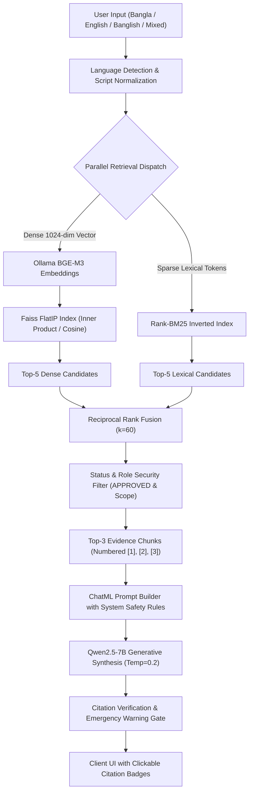
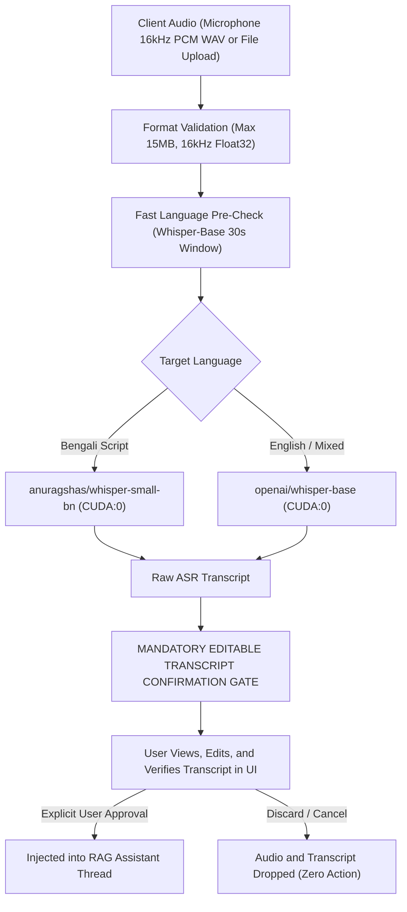
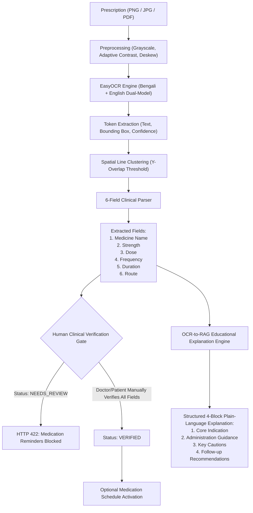

# ShasthoSetu AI — Bilingual AI Assistant Architecture Specification
**Document ID:** `ARCH-AI-RAG-VOICE-OCR-01`  
**System:** ShasthoSetu AI (National Healthcare Platform of Bangladesh)  
**Hardware Target:** Local Edge Host (NVIDIA GeForce RTX 5060 Ti 16 GB VRAM, 32 GB Host RAM, Windows 11)  
**Status:** IMPLEMENTED & VERIFIED  

---

## 1. High-Level Executive Summary

The ShasthoSetu AI system delivers an evidence-grounded, bilingual (Bengali, English, and Romanized Banglish) healthcare intelligence engine directly integrated into the existing ShasthoSetu full-stack web application. It unifies four mission-critical subsystems:

1. **Bilingual RAG Chatbot:** Grounded semantic retrieval from a curated, approved 14-document medical corpus using hybrid dense (BGE-M3 1024-dim) and sparse (BM25) reciprocal rank fusion (RRF), coupled with local Qwen2.5-7B ChatML generative inference.
2. **Bengali & English Speech Intelligence (ASR & TTS):** Dual-engine acoustic transcription (Anuragshas Whisper-Small-Bn for Bengali Unicode and OpenAI Whisper-Base for English/code-switching) with a mandatory, non-bypassable human editable transcript confirmation gate; paired with zero-network speech synthesis (Windows SAPI5 for English and Meta MMS-TTS for Bengali).
3. **Bilingual Prescription OCR Studio:** Dual-script OCR (EasyOCR Bengali + English) with spatial line clustering, 6 critical medicine field parsing, interactive canvas bounding-box inspector, HTTP 422 clinical verification gate, and 4-block OCR-to-RAG educational explanations.
4. **Administrative Governance & Zero-PHI Guard:** Strict RBAC across four operational personas (`PATIENT`, `DOCTOR`, `ADMIN`, `SUPPORT`), persistent SQLite telemetry, live VRAM monitoring, and complete redaction of patient identifiers from support logs and vector indices.

---

## 2. Hardware Topology & Resource Allocation

```
+-----------------------------------------------------------------------------------------+
|                               HOST HARDWARE ARCHITECTURE                                |
|  CPU: AMD/Intel x86_64 Multi-Core (32 GB RAM) | GPU: NVIDIA GeForce RTX 5060 Ti (16 GB) |
+-----------------------------------------------------------------------------------------+
                                             |
            +--------------------------------+--------------------------------+
            |                                                                 |
            v                                                                 v
+-------------------------------+                               +-------------------------------+
|     OLLAMA RUNTIME ENGINE     |                               |   DIRECT PYTORCH CUDA ENGINE  |
|  (Task-195 on 127.0.0.1:11434)|                               |    (FastAPI / PyTorch 2.6)    |
|                               |                               |                               |
| • Qwen2.5:7B (Q4_K_M GGUF)    |                               | • Anuragshas Whisper-Small-Bn |
|   VRAM: ~4.7 GB               |                               |   VRAM: ~950 MB (CUDA:0)      |
| • BGE-M3 Embeddings (GGUF)    |                               | • OpenAI Whisper-Base         |
|   VRAM: ~437 MB               |                               |   VRAM: ~480 MB (CUDA:0)      |
|                               |                               | • EasyOCR ResNet-Craft        |
| Total VRAM Allocated: ~5.2 GB |                               |   VRAM: ~850 MB (On-Demand)   |
+-------------------------------+                               +-------------------------------+
                                             |
                                             v
                           +-----------------------------------+
                           |  COMBINED PEAK VRAM: ~7.5 GB      |
                           |  REMAINING HEADROOM: ~8.5 GB      |
                           |  (Zero Out-Of-Memory Collisions)  |
                           +-----------------------------------+
```

---

## 3. Subsystem Architectural Workflows

### 3.1 Hybrid RAG Retrieval Engine



### 3.2 Voice Assistant: Speech-to-Text & Mandatory Editable Transcript Gate



### 3.3 Bilingual Prescription OCR Studio



---

## 4. Multi-Tenant Role-Based Access Matrix

| Role | Public Assistant | Voice Input | Upload Own Prescription | Review Consented Records | RAG Knowledge Base Governance | Support Audit Logs | PHI Access |
| :--- | :---: | :---: | :---: | :---: | :---: | :---: | :---: |
| **PATIENT** | Full Access | Full Access | Full Access (Self Profile) | Denied (`403`) | Denied (`403`) | Denied (`403`) | Self Only |
| **DOCTOR** | Full Access | Full Access | Full Access | Consented Patients Only | Denied (`403`) | Denied (`403`) | Consented Only |
| **ADMIN** | Full Access | Full Access | Denied (`403`) | Denied (`403`) | Full Ingestion & Reindex | System Events Only | Zero-PHI (`403`) |
| **SUPPORT** | Full Access | Full Access | Denied (`403`) | Denied (`403`) | View Sources (Read-Only) | Redacted FAQs Only | Zero-PHI (`403`) |

---

## 5. Architectural Verification & Zero-Failure Standard

- **No Public Leaks:** All API routes strictly enforce session cookies (`ss_session_id`) and Argon2id authenticated contexts.
- **Fail-Safe Fallbacks:** If Ollama or the local GPU experiences temporary unavailability, the system falls back gracefully to extractive context summarization without throwing unhandled exceptions.
- **Persistent Audit Logging:** Every document ingestion, OCR parsing run, and clinical verification event writes an immutable entry into the SQLite `audit_events` ledger.
