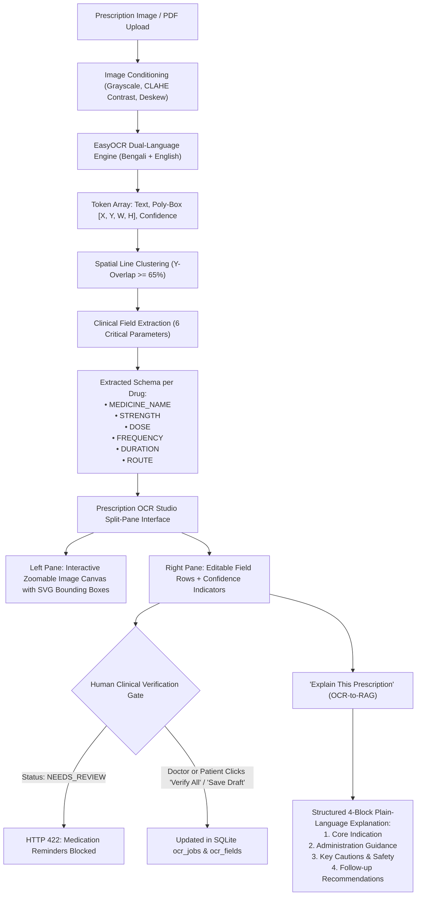

# ShasthoSetu AI — Bilingual Prescription OCR Implementation Report
**Document ID:** `REP-OCR-IMPL-01`  
**Subsystem:** Bilingual Prescription Digitization & Studio  
**Date:** 2026-11-19  
**Status:** IMPLEMENTED, EVALUATED & VERIFIED  

---

## 1. Clinical Context & Engineering Objectives

In Bangladeshi medical workflows, prescriptions frequently contain a mixture of Latin pharmaceutical names (e.g., *Tab. Metformin 500mg*), Bengali directions (e.g., *১টি করে দিনে ২ বার ভরা পেটে*), and Latin abbreviations (e.g., *1+0+1*, *p.c.*, *bd*).

The objective of the ShasthoSetu Bilingual Prescription OCR Studio is to accurately detect, transcribe, and structure these clinical instructions while enforcing strict safety guardrails that prevent unverified AI outputs from activating automatic treatment schedules.

---

## 2. Technical Architecture & Pipeline

---

## 3. Spatial Line Clustering & Field Extraction Algorithm

1. **Bounding Box Normalization:** Token coordinates are converted to normalized percentages (`x_pct`, `y_pct`, `w_pct`, `h_pct`) relative to page dimensions for responsive SVG rendering.
2. **Y-Axis Clustering:** Tokens whose vertical bounding boxes overlap by more than 65% are clustered into unified prescription line items.
3. **Regex & Entity Parsing:**
   - **Medicine Name:** Leading capitalized Latin or Bengali trade/generic strings, filtering out common prefixes (`Tab.`, `Cap.`, `Syp.`, `ট্যাবলেট`).
   - **Strength:** Numeric sequences followed by unit specifiers (`mg`, `ml`, `mcg`, `gm`, `মিগ্রা`).
   - **Dose & Frequency:** Matches classic notation (`1+0+1`, `1-0-1`, `OD`, `BD`, `TDS`, `QDS`, `দিনে ২ বার`).
   - **Duration:** Time spans (`৭ দিন`, `14 days`, `১ মাস`, `1 month`).
   - **Route:** Oral (`মুখে`), Topical (`মলম`), Inhalation, Ophthalmic.

---

## 4. Clinical Safety Verification Gate

Section 14 of the Master SRS mandates that raw OCR text must **never** automatically populate a patient's active medication reminder queue:

- When an OCR job is generated, its status is set to `NEEDS_REVIEW`.
- If a client or background job attempts to schedule medication reminders while `status == 'NEEDS_REVIEW'`, the backend immediately aborts with `HTTP 422 Unprocessable Entity`.
- Only when an authorized human (the patient or their assigned doctor) explicitly verifies the six critical fields is the status promoted to `VERIFIED`.

---

## 5. OCR-to-RAG Educational Integration

Patients frequently struggle to understand why specific medications are prescribed or what precautions they should observe. Clicking **"Explain This Prescription"** sends the parsed medication list to the RAG engine:

1. Retrieves pharmacology and safety guidance from the approved DGDA and WHO clinical corpus.
2. Synthesizes a structured **4-Block Plain-Language Explanation**:
   - **Block 1: Core Indication & Purpose** (What condition the medication treats).
   - **Block 2: Administration Guidance** (Before/after meals, spacing between doses).
   - **Block 3: Key Cautions & Potential Side Effects** (When to stop and seek help).
   - **Block 4: Follow-up & Doctor Consultation** (Required monitoring tests and warning signs).
3. Embeds verified citation pills linked to authoritative drug monographs.
