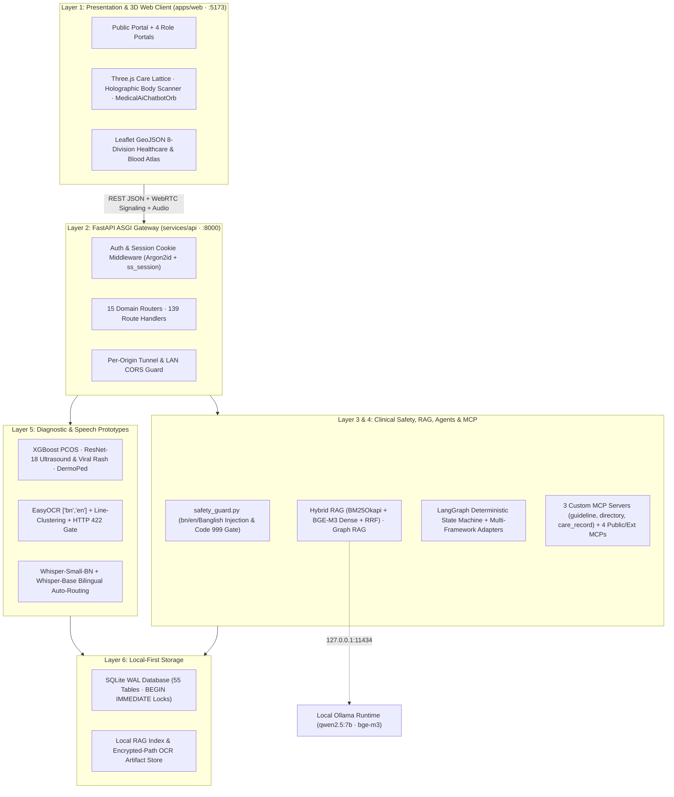

# ShasthoSetu AI — System Architecture Guide

This document details the six architectural layers connecting the **React 19 + Three.js frontend**, **FastAPI 15-router API gateway**, **Hybrid RAG & LangGraph orchestration**, **MCP hub**, **6 clinical ML/DL prototypes**, and **55-table SQLite WAL persistence engine**.

---

## 1. End-to-End Topology

---

## 2. Database Engine & Concurrency (`services/api/src/shasthosetu_api/db/`)

- **Schema Scope:** **55 SQLite tables** defined in [`schema.sql`](../services/api/src/shasthosetu_api/db/schema.sql) spanning authentication (`users`, `sessions`, `role_memberships`), clinician directory (`doctor_profiles`, 43 verified clinicians), appointments, simulated fee receipts, prescriptions (`ocr_job_artifacts`, `medication_plans`), PCOS logs, Blood Connect requests across 8 divisions, support tickets, RAG governance (`rag_sources`, `rag_chunks`), and immutable audit trails (`audit_logs`).
- **Write-Ahead Logging (`sqlite.py`):** Every connection executes `PRAGMA journal_mode = WAL`, `PRAGMA synchronous = NORMAL`, `PRAGMA foreign_keys = ON`, and `PRAGMA busy_timeout = 5000`.
- **Atomic Booking Locks:** Slot reservations and critical state transitions execute inside explicit `BEGIN IMMEDIATE` transactions (`begin_immediate`) so concurrent patients cannot double-book the same doctor slot (`HTTP 409 Conflict`).

---

## 3. Bilingual Hybrid RAG & LangGraph State Machine

- **Corpus & Chunks:** 14 admin-approved bilingual reference documents segmented into 35 audited chunks (11 medical DGHS/WHO summaries + 3 platform guides).
- **Hybrid Reciprocal Rank Fusion (`rag_engine.py`):** Combines `BM25Okapi` lexical ranking (`2.62 ms` mean latency) with 1024-dimensional `bge-m3` dense embeddings (`FAISS`), reaching **95.00% Recall@1**, **100.00% Recall@3**, and **0.9750 MRR** on the 20-query medical benchmark.
- **Language Routing (`detect_script_language`):** Distinguishes Bengali script (`bn`), English (`en`), Romanized Banglish (`banglish`), and code-switched queries (`mixed`) prior to prompt synthesis.
- **Multi-Agent Orchestration (`services/agents/`):** Runs a deterministic **LangGraph** triage workflow live at `/v1/agents/orchestrate`, alongside offline cross-audit adapters for **AutoGen**, **CrewAI**, and **OpenAI Agents SDK**.

---

## 4. Two-Device WebRTC Telemedicine Signaling (`routers/consultations.py`)

- **Payment-Before-Call Enforcement:** Unpaid appointments cannot enter active teleconsultation rooms; patients complete simulated fee payment and `ConsultationPreparationModal` intake first.
- **Room Signaling Lifecycle (`/v1/consultations/rooms/{room_id}/*`):** Supports peer join with stale-peer eviction (`> 60s`), typed SDP/ICE signal relay (`offer`, `answer`, `ice`, `ready`, `call_mode`, `end_call`), and synchronized in-room clinical chat (`apt-demo-9001`).

---

## 5. Frontend 3D Twins, Gyroscopic Orb & White/Dark Themes (`apps/web/src/`)

- **Three.js / React Three Fiber Scenes:** `HeroCareLattice.tsx`, `AiModuleScene3D.tsx`, and `HolographicBodyScanner3D.tsx` render interactive clinical geometries with motion-pause fallback (`prefers-reduced-motion` / user toggle).
- **Gyroscopic `MedicalAiChatbotOrb.tsx`:** Uses a 60 FPS `requestAnimationFrame` SVG loop rotating counter-spinning rings cleanly around `(50, 50)`, with cursor-tracking pupils, natural blink intervals, reactive audio bars, and an expandable radial menu (`ShasthoSetuRadialMenu.tsx`) linking to the 5-member team modal and GitHub.
- **Bilingual & Theme System (`tokens.css` & `preferences.tsx`):** Persists `en`/`bn` locale and **Obsidian Dark** vs **Clinical Daylight White Mode** across the public navbar and all four authenticated portal shells.
