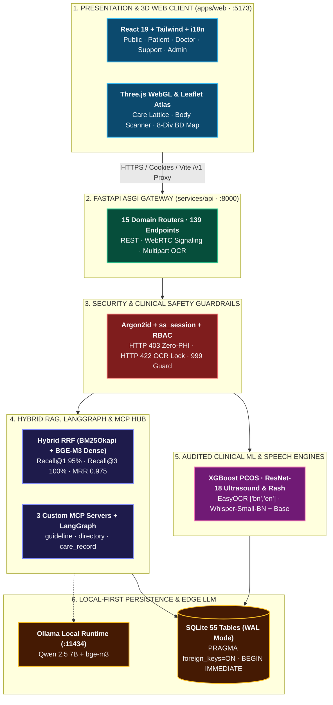
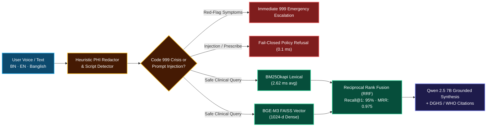

# ShasthoSetu AI — System Architecture Guide (`Colorful Mermaid Topology`)

This document details the six architectural layers connecting the **React 19 + Three.js frontend**, **FastAPI 15-router API gateway**, **Hybrid RAG & LangGraph orchestration**, **MCP hub**, **6 clinical ML/DL prototypes**, and **55-table SQLite WAL persistence engine**.

---

## 1. End-to-End 6-Layer System Topology

---

## 2. Database Engine & Concurrency (`services/api/src/shasthosetu_api/db/`)

- **Schema Scope:** **55 SQLite tables** (`54` defined in [`schema.sql`](../services/api/src/shasthosetu_api/db/schema.sql) + `webhook_replay_nonces` created in [`agents_and_automation.py`](../services/api/src/shasthosetu_api/routers/agents_and_automation.py)). Full catalog documented in [`DATABASE.md`](DATABASE.md).
- **Write-Ahead Logging (`sqlite.py`):** Every connection executes `PRAGMA journal_mode = WAL`, `PRAGMA synchronous = NORMAL`, `PRAGMA foreign_keys = ON`, and `PRAGMA busy_timeout = 5000`.
- **Atomic Slot Locks:** Appointment bookings wrap inside explicit `BEGIN IMMEDIATE` transactions (`begin_immediate`) preventing concurrent slot collisions (`HTTP 409 Conflict`).

---

## 3. Bilingual Hybrid RAG & Safety Triage Flow

---

## 4. Safe-OCR `HTTP 422` Verification & Telemedicine Flow

```mermaid
sequenceDiagram
    autonumber
    actor P as Patient / User
    participant API as FastAPI Safe-OCR Service
    participant DB as SQLite Medication Plans
    participant MD as Approved Clinician

    P->>API: POST /v1/ai/ocr/extract (PDF / JPG / PNG)
    API->>API: EasyOCR (['bn','en']) + Line Clustering + Confidence Audit
    API-->>P: RAW_OCR Tokens + Uncertain Span Warnings

    rect rgb(75, 18, 28)
        Note over P,API: Safety Interlock — Unverified Dosages Blocked
        P->>API: Attempt Automated Reminder Activation (Unconfirmed)
        API-->>P: HTTP 422 Unprocessable Entity (Blocked Until Confirmation)
    end

    rect rgb(12, 58, 45)
        Note over P,MD: Human Verification Unlocked
        P->>API: Explicit Draft Confirmation (or Route to MD)
        MD->>API: Clinician Verification Sign-off
        API->>DB: Save Authorized Plan + Audit Trail
        API-->>P: 201 Created — Verified Medication Routine Active
    end
```

---

## 5. Frontend 3D Twins, Gyroscopic Orb & White/Dark Themes (`apps/web/src/`)

- **Three.js / React Three Fiber Scenes:** `HeroCareLattice.tsx`, `AiModuleScene3D.tsx`, and `HolographicBodyScanner3D.tsx` render interactive clinical geometries with motion-pause fallback (`prefers-reduced-motion` / manual toggle).
- **Gyroscopic `MedicalAiChatbotOrb.tsx`:** Uses a 60 FPS `requestAnimationFrame` SVG loop rotating counter-spinning rings cleanly around `(50, 50)`, with cursor-tracking pupils, natural blink intervals, reactive audio bars, and an expandable radial menu (`ShasthoSetuRadialMenu.tsx`) linking to the 5-member `TeamRosterModal` and GitHub.
- **Bilingual & Theme System (`tokens.css` & `preferences.tsx`):** Persists `en`/`bn` locale and **Obsidian Dark** vs **Clinical Daylight White Mode** across public and portal headers.
