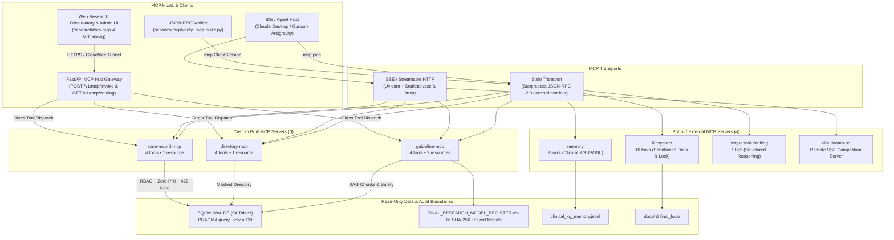

# ShasthoSetu AI — Model Context Protocol (MCP) Architecture

> **Compliance & Scope:** Implements all 3 competition rubric pillars for Category 11 (`MCP — Built + Used + Architecture`): **3 custom-built MCP servers**, **3+ integrated & live-verified public MCP servers** (plus competition `cloudcamp-bd` SSE endpoint), and full transport, client/host, permission boundary, and tool-reusability documentation backed by live JSON-RPC verification evidence at [mcp_verification_report.json](evidence/INT_01/mcp_verification_report.json).

---

## 1. Inventory Overview (3 Built + 4 Configured/Integrated)

### A. Custom MCP Servers Built (`services/mcp/`)

| Server ID | Implementation | Tools Exposed | Resources Exposed | Transports Supported | Default HTTP Ports | Security & Privacy Scope |
| :--- | :--- | :---: | :---: | :--- | :---: | :--- |
| **`guideline-mcp`** | `services/mcp/guideline_mcp.py` | 4 (`search_clinical_guidelines`, `list_approved_rag_sources`, `get_frozen_model_register`, `check_clinical_safety_guard`) | 2 (`guideline://rag/status`, `guideline://audit/final-lock`) | `stdio`, `sse`, `streamable-http` | SSE `8101`, HTTP `8111` | **Read-Only Public/Clinician.** Admin-approved RAG chunks, 16-checkpoint SHA-256 register, 999 emergency & injection safety screen. Zero PHI. |
| **`directory-mcp`** | `services/mcp/directory_mcp.py` | 4 (`find_approved_doctors`, `get_department_counts`, `search_facilities_and_diagnostics`, `find_blood_requests_safe`) | 1 (`directory://overview`) | `stdio`, `sse`, `streamable-http` | SSE `8102`, HTTP `8112` | **Read-Only Public Masked.** Exposes 43 verified demo clinicians, 12 tests, 12 facilities, and Blood Connect requests with **`HIDDEN_UNTIL_CONSENT`** phone masking. |
| **`care-record-mcp`** | `services/mcp/care_record_mcp.py` | 4 (`get_patient_care_summary`, `list_pending_ocr_reviews`, `check_medication_activation_gate`, `list_immutable_audit_summary`) | 1 (`care://policy/acl-matrix`) | `stdio`, `sse`, `streamable-http` | SSE `8103`, HTTP `8113` | **Strict RBAC + Zero-PHI.** Bars `SUPPORT` (`ERR_ZERO_PHI_FORBIDDEN`), enforces mandatory **`HTTP 422`** OCR verification gate, restricts audit logs to `ADMIN` (`ERR_ADMIN_ONLY`). |

### B. Public & External MCP Servers Integrated (`.mcp.json`)

| Server ID | Package / Endpoint | Transport | Tools Verified (`stdio`) | Sandbox / Storage Boundary |
| :--- | :--- | :---: | :---: | :--- |
| **`filesystem`** | `@modelcontextprotocol/server-filesystem` | `stdio` | **16 tools** (`PASS`) | Strictly sandboxed to `docs/` and `SHASTHOSETU_FINAL_DATASET_MODEL_AUDIT/final_lock/` (blocks writes/reads outside allowed roots). |
| **`memory`** | `@modelcontextprotocol/server-memory` | `stdio` | **9 tools** (`PASS`) | Backed by `services/mcp/data/clinical_kg_memory.jsonl` storing ShasthoSetu clinical AI & MCP knowledge graph entities/relations. |
| **`sequential-thinking`** | `@modelcontextprotocol/server-sequential-thinking` | `stdio` | **1 tool** (`PASS`) | Structured multi-step chain-of-thought verification for safety/triage reasoning without accessing patient PII. |
| **`cloudcamp-bd`** | `https://cloudcamp-bd-mcp.equisaas-bd.com` | `sse` | Remote HTTP SSE probe (`HTTP 403` without client token) | Configured in `.mcp.json` competition server entry; external hosted endpoint. |

---

## 2. End-to-End Topology Diagram



---

## 3. Transport Architecture (`Stdio` vs `SSE` vs `Streamable HTTP`)

Every custom server uses `mcp.server.mcpserver.MCPServer` (`mcp >= 2.3.0`) and a shared transport dispatcher in `services/mcp/common.py` (`run_mcp_server`), supporting **three standard transports** with one CLI flag (`--transport stdio | sse | streamable-http`):

| Transport | Wire Mechanism | When Used in ShasthoSetu | Process & Security Boundary |
| :--- | :--- | :--- | :--- |
| **`stdio`** | Length/newline-delimited JSON-RPC 2.0 over child process `stdin`/`stdout` | Default in `.mcp.json` for local desktop agents (`Cursor`, `Claude Desktop`, `Antigravity`) and CI/CLI verification (`verify_mcp_suite.py`) | Zero network socket exposure; inherits strict OS user privileges and explicit `SHASTHOSETU_DB_PATH` read-only env var. All logs go to `stderr` so `stdout` stays pure JSON-RPC. |
| **`sse`** | Server-Sent Events (`GET /sse` + `POST /messages/`) via Starlette ASGI + Uvicorn (`sse_app`) | Legacy HTTP MCP clients, `cloudcamp-bd` (`https://cloudcamp-bd-mcp.equisaas-bd.com`), and remote agent runners over Cloudflare Tunnel | Binds `127.0.0.1` by default (ports `8101–8103`); can be tunneled over TLS without exposing raw SQLite files. |
| **`streamable-http`** | MCP 2025/2026 unified `/mcp` HTTP endpoint (`streamable_http_app`) | Modern remote MCP hosts and container/cloud orchestrators (`ports 8111–8113`) | Stateless or session-scoped JSON/SSE HTTP responses with `TransportSecuritySettings` host validation (`host="127.0.0.1"`). |

Example CLI invocations:
```powershell
# Stdio (default for IDE / .mcp.json hosts)
python services/mcp/guideline_mcp.py --transport stdio

# SSE endpoint (http://127.0.0.1:8101/sse)
python services/mcp/guideline_mcp.py --transport sse --port 8101

# Streamable HTTP endpoint (http://127.0.0.1:8111/mcp)
python services/mcp/directory_mcp.py --transport streamable-http --port 8112
```

---

## 4. Client / Host Disclosure

| Component | Role in MCP Spec | How It Connects | Disclosure Notes |
| :--- | :--- | :--- | :--- |
| **Claude Desktop / Cursor / Antigravity IDE** | **Host** (contains built-in MCP Client) | Reads root `.mcp.json` (`mcpServers`) and spawns each server over `stdio` or connects to `cloudcamp-bd` via `sse` | User grants workspace trust; tool schemas auto-discovered on `initialize()` -> `tools/list`. |
| **`services/mcp/verify_mcp_suite.py`** | **Headless MCP Client** (`mcp.ClientSession`) | Uses `mcp.client.stdio.stdio_client` + `StdioServerParameters` | Runs live protocol handshakes (`initialize`, `list_tools`, `list_resources`, `call_tool`) across all 3 custom + 3 public `stdio` servers and saves proof to `docs/evidence/INT_01/mcp_verification_report.json`. |
| **FastAPI MCP Hub Router (`services/api/src/shasthosetu_api/routers/mcp_hub.py`)** | **Web API Bridge / Host Gateway** | Exposes `GET /v1/mcp/catalog` & `POST /v1/mcp/invoke` directly calling the audited tool implementations in `services/mcp/*` | Allows judges and browser users on `/research#res-mcp` and `/admin/rag` (locally or via Cloudflare Tunnel) to test MCP tools interactively without installing a local desktop client. |

---

## 5. Permission Boundaries, RBAC & Zero-PHI Enforcement

All custom database access opens SQLite via `file:...?mode=ro` with `PRAGMA query_only = ON;` (`services/mcp/common.py`), guaranteeing **zero SQL write capability** over MCP even if prompt injection occurs. On top of read-only storage, each server enforces strict domain boundaries:

| Caller Role | `guideline-mcp` (RAG & 16 Models) | `directory-mcp` (Doctors, Labs, Blood) | `care-record-mcp` (`get_patient_care_summary` / `list_pending_ocr_reviews`) | `care-record-mcp` (`check_medication_activation_gate`) | `care-record-mcp` (`list_immutable_audit_summary`) |
| :--- | :--- | :--- | :--- | :--- | :--- |
| **`GUEST` / Public** | **Allowed** (non-diagnostic RAG excerpts + safety check) | **Allowed** (Blood phones strictly masked as `HIDDEN_UNTIL_CONSENT`) | **Denied** (`ERR_ROLE_DENIED`) | Read-only gate check (`200` vs `422`) | **Denied** (`ERR_ADMIN_ONLY`) |
| **`PATIENT`** | **Allowed** | **Allowed** (phone masking enforced) | **Scoped** (`owner_user_id` ownership check, phones & `emergency_contact` scrubbed) | **Allowed** (cannot auto-activate reminders if `HTTP 422`) | **Denied** (`ERR_ADMIN_ONLY`) |
| **`DOCTOR`** | **Allowed** | **Allowed** | **Allowed** (summarized counts + OCR review status, PII scrubbed) | **Allowed** | **Denied** (`ERR_ADMIN_ONLY`) |
| **`SUPPORT`** | **Allowed** (approved FAQ/guideline snippets only) | **Allowed** | **BLOCKED (`ERR_ZERO_PHI_FORBIDDEN`)** — zero clinical PHR/OCR access | Non-PHI boolean status only | **Denied** (`ERR_ADMIN_ONLY`) |
| **`ADMIN`** | **Allowed** | **Allowed** | **Allowed** (synthetic/scrubbed ops metadata) | **Allowed** | **Allowed** (redacted `audit_logs` summary) |

### Additional Built-In Safeguards
1. **Prompt Injection & Clinical Boundary Guard (`check_clinical_safety_guard`):** Screens text against Bangladesh 999 red flags and jailbreak patterns (`safety_guard.py`).
2. **Mandatory HTTP 422 OCR Verification Gate (`check_medication_activation_gate`):** Explicitly confirms whether `ocr_job_artifacts.authorization_state` is human-verified (`CLINICIAN_VERIFIED` / `PATIENT_ACKNOWLEDGED`) before medication reminders can be activated; `RAW_OCR` returns `http_gate_code: 422`.
3. **Blood Connect Consent Privacy (`find_blood_requests_safe`):** Returns aggregated donor availability counts and hospital verification badges while enforcing `contact_phone_policy: "HIDDEN_UNTIL_CONSENT"` (raw donor phone numbers are never serialized onto MCP output).
4. **Public `filesystem` Sandbox:** `@modelcontextprotocol/server-filesystem` is restricted solely to `docs/` and `SHASTHOSETU_FINAL_DATASET_MODEL_AUDIT/final_lock/` — preventing traversal into `services/api/data/` or `.env` files.

---

## 6. Tool Reusability Across Surfaces

Every tool in `services/mcp/` follows a **single-implementation, multi-surface** pattern:
- **IDE & CLI AI Agents:** Connect over `stdio` or `SSE` via `.mcp.json` and call `search_clinical_guidelines`, `find_approved_doctors`, `get_frozen_model_register`, or `check_medication_activation_gate`.
- **Interactive Web Observatory (`/research#res-mcp`) & Admin Governance (`/admin/rag`):** Reuse the exact same Python functions via FastAPI `POST /v1/mcp/invoke` (`mcp_hub.py`) — zero duplicate SQL queries or diverging privacy rules.
- **Persistent Knowledge Memory:** `@modelcontextprotocol/server-memory` persists architecture/module entities in `services/mcp/data/clinical_kg_memory.jsonl`, reusable across debugging and governance sessions.

---

## 7. Live Verification Results (`docs/evidence/INT_01/mcp_verification_report.json`)

Executed via official `mcp.ClientSession` + `mcp.client.stdio.stdio_client`:
- **Custom MCP Servers Passed:** **3 / 3** (`guideline-mcp` `4` tools + `2` resources, `directory-mcp` `4` tools + `1` resource, `care-record-mcp` `4` tools + `1` resource)
- **Public `stdio` MCP Servers Passed:** **3 / 3** (`filesystem` `16` tools, `memory` `9` tools, `sequential-thinking` `1` tool)
- **Zero-PHI Support Desk Block Verified:** `true` (`get_patient_care_summary(requester_role="SUPPORT")` returned `ERR_ZERO_PHI_FORBIDDEN`)
- **Blood Connect Phone Masking Verified:** `true` (`privacy_gate: "ZERO_PHI_PHONE_MASKING_ENFORCED"`)
- **Remote Competition SSE Server (`cloudcamp-bd`):** Configured in `.mcp.json` (`https://cloudcamp-bd-mcp.equisaas-bd.com`), probed HTTP `403` (endpoint live, requires authenticated SSE client session).
